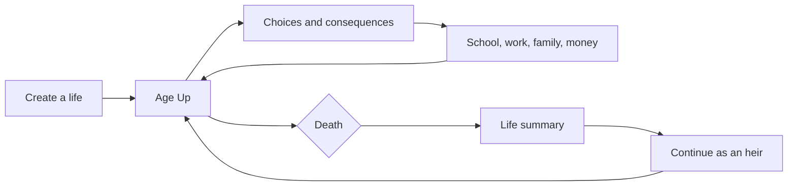

# Maisha

**Live your story. One year at a time.**

Maisha (Swahili for *life*) is a single-player **life simulator** for Android. Create a character, tap **Age Up**, and watch a whole life unfold — school, work, love, money, trouble, and the family you leave behind.

It plays in the same space as BitLife and Age Sim, built for **mid-range phones** and designed to feel **local** in **15 countries**, not like a US template with flags stuck on.

<p>
  
  
  
  
</p>

---

## Play a life

You start with a name, a country, a face, and a handful of stats. Then every year is a choice.

| You live | What that means in Maisha |
|----------|---------------------------|
| **Childhood & school** | Classmates, crushes, bullies, clubs, exams with local names, detention, university majors and loans |
| **Work** | Country job pools, performance and office politics, part-time gigs, side hustles, career ladders, fame and talent tracks |
| **People** | Parents, siblings, dating, marriage, children, pets, friends, enemies |
| **Money** | Cash, homes and cars, upkeep, investments, businesses, a will |
| **Risk** | Crime, arrest, prison, illness, doctors, relocation and citizenship |
| **Time** | Yearly quests, achievements, death, then **legacy** — continue as a child and keep the family line going |

Three save slots. Offline-first. Your lives stay on the device.

### A year on the phone

1. Open **Life** and tap **Age Up**.
2. Face an event — or several — with real trade-offs.
3. Spend the year on **Actions**, **Relationships**, **Career**, or **Assets**.
4. Repeat until the story ends. Share a life card if you want bragging rights.



---

## 15 countries, local flavor

Kenya, Nigeria, South Africa, Egypt, the United States, Canada, the United Kingdom, France, Germany, India, Japan, the Philippines, Indonesia, Brazil, and Mexico.

Each country has its own **names**, **jobs**, **housing**, **exam names**, **holidays**, **hospitals**, **money apps**, and **economy scale**. Event text uses placeholders like `{transportMode}`, `{secondaryExam}`, and `{moneyApp}` so a matatu in Nairobi and a jeepney in Manila are not the same sentence with the flag swapped.

UI strings ship in English plus Swahili, Spanish, French, Portuguese, and Hindi. Narrative events are authored in English.

---

## Built like a game, not a prototype

| Layer | What it does |
|-------|----------------|
| **Compose + Material 3** | Screens, tabs, event dialogs |
| **MVVM + Hilt** | ViewModels own state; UI reads `StateFlow` |
| **Domain engines** | Pure Kotlin rules — no `Context`, no Room, no Compose |
| **Room** | Three character slots and durable saves |
| **DataStore** | Sound, language, tips, and other preferences |
| **JSON events** | Hundreds of authored life events in `app/src/main/assets/data/events/` |
| **WorkManager** | Optional local reminders |
| **AdMob** | Optional ads (debug uses Google sample units) |

```
Compose screens  →  ViewModels  →  GameEngine  →  feature engines
                                      ↓
                         Room / DataStore / event JSON
```

`GameEngine` runs the yearly tick. Feature engines own their slice of life: education, career, relationships, finance, crime, health, politics, relocation, skills, social media, achievements, mortality, and legacy.

---

## Run it

**Needs:** Android Studio (Ladybug or newer), JDK 17, Android SDK 35. `minSdk` is 26.

```bash
./gradlew assembleDebug
./gradlew :app:installDebug
./gradlew testDebugUnitTest
```

Open the project root in Android Studio, sync Gradle, and run `app` on a **360dp-class** phone or emulator (Pixel 4a, or similar). Primary QA devices during development were budget Android 13 phones in that size class.

First launch: splash → onboarding → slot picker → character creation → avatar → stats → the life screen.

Release ads stay off until you set real AdMob unit IDs in `gradle.properties` (`ADMOB_INTERSTITIAL`, `ADMOB_REWARDED`, `ADMOB_BANNER`).

---

## Repo map

```
app/src/main/java/com/maisha/game/
  domain/          Game rules (pure Kotlin)
  data/            Catalogs, Room, EventRepository
  ui/              Compose screens and ViewModels
  ads/             AdMob wrappers
  notifications/   WorkManager
  feedback/        Sound and haptics
app/src/main/assets/data/events/   Life event packs
app/src/test/                      Domain and content tests
docs/PRIVACY_POLICY.md
docs/AI_CONTINUITY_PROMPT.md       Maintainer / agent handoff
```

### Adding a life event

1. Put it in the right JSON pack under `assets/data/events/`.
2. Give it a unique `id`, an age range, `text`, and `choices`.
3. Gate it with tags (`one_time`, `requires_job`, `education`, `requires_spouse`, …).
4. If you add a new file, load it in `EventRepository` and list it in `GlobalContentCoverageTest`.

Schema notes live in [`app/src/main/assets/data/events/README.md`](app/src/main/assets/data/events/README.md).

---

## Privacy

Saves stay on the device. See [docs/PRIVACY_POLICY.md](docs/PRIVACY_POLICY.md).

---

## License

Unlicensed. All rights reserved unless the owner says otherwise.
