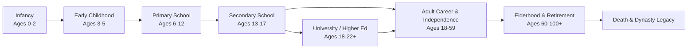

# Maisha — Master Game Overview & Design Specification

> **Document Type:** Master Game Design & Technical Systems Overview  
> **Package:** `com.maisha.game`  
> **Platform:** Android (minSdk 26, targetSdk 35)  
> **Primary Audience:** Game designers, developers, AI agents, and contributors.

---

## 1. Executive Summary & Design Pillars

**Maisha** (Swahili for *life*) is a rich, offline-first, single-player life simulation mobile game for Android in the BitLife / Age Sim genre. Players create a custom human character and guide them year-by-year from birth to death, making decisions across education, career, relationships, finances, crime, fame, and legacy. When a character passes away, the player receives a detailed obituary, an archetype tombstone ribbon, and can continue their family dynasty as one of their surviving children.

### Core Design Pillars

1. **Player Agency Between Age-Ups:** Rather than relying exclusively on passive random event cards, Maisha provides deep, interactive agency across five core tabs (Life, Actions, Family, Career, Assets). Every year gives players meaningful things to *do* — schmoozing bosses, asking out dating candidates, practicing in school clubs, or buying real estate.
2. **True Global Flavor:** The game natively supports **15 countries** (Kenya, Nigeria, South Africa, Egypt, USA, Canada, UK, France, Germany, India, Japan, Philippines, Indonesia, Brazil, Mexico). Rather than swapping flags over a US template, each country features customized currencies, authentic name catalogs, national exam systems, real transport modes, mobile money apps, holidays, and localized economy baselines.
3. **Offline-First Resilience:** 100% of core narrative packs and game engines run locally on the device with zero network dependence. Network operations (like background flavor data prefetching) are purely optional and fail gracefully.
4. **Clean Domain Purity:** Business logic is isolated in pure Kotlin domain engines with no Android dependencies (`Context`, `Bitmap`, `View`, `Compose`). ViewModels orchestrate data streams via `StateFlow`, while Jetpack Compose powers the UI.

---

## 2. Life Stages & Progression Model

A character's journey is divided into seven structured life stages, each with tailored mechanics, unlocked agency, and strict age gating:



### Stage 1: Infancy (Ages 0–2)
- **Mechanics:** Characters are helpless newborns/toddlers. Minors at this stage are completely shielded from macroeconomic stress, taxation, and inflation spam.
- **Available Actions:** Specially gated infant interactions: *Cuddle & Bond with Parents*, *Babble & Smile*, and *Throw Tantrums*.
- **Visuals:** Avatar displays infant chubby cheeks and no hair/minimal baby tufts. Facial hair and accessories are strictly forbidden.

### Stage 2: Early Childhood (Ages 3–5)
- **Mechanics:** Exploration of the home environment and preschool. Infancy protections (0-2) strictly preserved.
- **Childhood Aptitude Seeds (Ages 4-10):** Characters begin exploring obsessions across 5 tracks: *Athletics*, *Arts & Music*, *Tech & Tinkering*, *Academics*, and *Street Hustle*. Practicing hobbies builds mastery scores and stat boosts that carry into high school clubs, university scholarships, and adult careers.
- **Available Actions:** Exploring childhood hobbies, playing with toys, spending time with parents, doing chores (boosting parental trust), and interacting with siblings (team ups, borrowing items with break risks, and sibling rivalry flags).
- **Career/School Tab:** Displays `EarlyChildhoodCard` and an interactive `ChildhoodAptitudeCard` for discovering and practicing early talents.

### Stage 3: Primary & Middle School (Ages 6–14)
- **Mechanics:** Automatic enrollment into local primary school. Academic GPA (0.0–4.0) tracking begins.
- **Ages 6–10 (Elementary):** Focus on foundational habits, chores, hobbies, and sibling relationships. Parental allowance requests are gated by parental trust (minimum 45/100).
- **Ages 11–14 (Middle School, Cliques & Reputation):**
  - *School Social Cliques:* Characters can join and socialize with distinct cliques: *Academic Nerds*, *Varsity Jocks*, *Hallway Rebels*, *Popular Crowd*, and *The Outcasts*. Joining cliques checks stat qualifications or childhood aptitudes.
  - *Social Agency:* Hang out with cliques to raise standing, pass secret notes between classmates, confront or befriend school bullies, and execute playground trading hustles (age 10-14) for pocket cash with detention risk.
  - *School People Roster:* Dynamic Classmates, Best Classmate, Teachers, and School Bully on `education.schoolPeople` (never in `Character.family`).
  - *School Activities:* 1 academic and 1 social activity per year (Study groups, library cram, teacher consultation, confronting bullies, playground hustles).
  - *Discipline:* Misbehavior leads to detentions, parental trust deductions, and expulsion hearings.
- **National Milestone:** Primary School Leaving Exam (e.g. KCPE in Kenya, DepEd NAT in Philippines).

### Stage 4: Secondary / High School (Ages 15–18)
- **Mechanics:** Transition to secondary school with high school social dynamics, rebellion, and parental oversight.
- **Parental Trust & Curfew Tension:** Teen characters have a dynamic curfew hour (default 9:00 PM / 21:00). High trust (70+) allows requesting later curfews (up to 11:00 PM). Sneaking out after curfew risks getting caught, causing strict groundings, trust penalties (-25), and curfew tightening to 8:00 PM.
- **School Clubs:** Join Debate, Football/Soccer, Drama, Coding, or Music clubs with skill bonuses derived from childhood aptitudes. Progress through ranks (*Member* &rarr; *Officer* &rarr; *Captain*), lead fundraisers, and compete in rivalries.
- **Student Part-Time Jobs:** Unlocks at age 16. Characters manage energy levels while balancing hard study, side hustles, and first paychecks.
- **Exam Integrity:** Choose to study hard, study normal, cram, or cheat on high school exams. Cheating risks immediate expulsion hearings or sets long-lasting consequence flags (`cheatedOnExam`, `caughtCheatingOnExam`).
- **Age 18 Crossroads Milestone:** Transitioning from age 17 to 18 automatically triggers a commemorative milestone evaluation summarizing academic graduation honors, childhood aptitude mastery, and family trust standing, while lifting curfews and unlocking adult autonomy.
- **National Milestone:** High school graduation exams (e.g. KCSE, WAEC, SAT, GCSE, Abitur, Baccalauréat).

### Stage 5: University & Higher Education (Ages 18–22+)
- **Mechanics:** Optional post-secondary education across 7 specialized majors:
  - Computer Science, Law, Medicine, Business, Communications, Engineering, Nursing.
- **Funding Models:** Cash upfront, merit-based Scholarships, or Student Loans with annual interest accrual.
- **Campus Life:** Greek life / campus mixers, professor office hours, all-nighter exam crams, campus rivalry pranks, campus work-study jobs, and corporate internships.
- **Graduation Honors:** *Cum Laude*, *Magna Cum Laude*, or *Summa Cum Laude*, unlocking direct corporate career track offers.

### Stage 6: Adulthood & Career Independence (Ages 18–59)
- **Full Independence:** Gated adult systems unlock: full-time job applications, starting businesses, political campaigns, real estate mortgages, luxury vehicle purchases, dating app matchmaking, marriage, prenups, having children, and independent health insurance.
- **Corporate Ladders:** Climb through 6 corporate ranks from Entry-Level to C-Suite Executive.
- **Workplace Roster:** Manage relationships with Supervisors (Strictness & Competence) and Coworkers (Schmoozing, Raises, Promotions, HR reporting, Pranks).
- **Alternative Pathways:** Professional athletics, music entertainment, military service, startup entrepreneurship, or criminal enterprises.

### Stage 7: Elderhood, Retirement & Mortality (Ages 60–100+)
- **Mechanics:** Retirement pensions, senior health challenges, social security, grandparenthood.
- **Estate Planning:** Executing wills and testaments.
- **Mortality:** Annual mortality checks scaling with age, health, and lifestyle hazards.
- **Legacy:** Silk-sash tombstone ribbons awarded; option to continue dynasty as an adult child heir.

---

## 3. Complete Domain Engine Inventory

All business rules reside in pure Kotlin engines within `com.maisha.game.domain.*`:

```
com.maisha.game.domain/
  ├── GameEngine.kt               (Central coordinator and yearly tick facade)
  ├── EducationEngine.kt          (Primary, secondary, university, clubs, exams, rosters)
  ├── CareerEngine.kt             (Jobs, corporate ladders, workplace agency, talent tracks)
  ├── RelationshipEngine.kt       (Family, matchmaking, dating, marriage, prenups, pets)
  ├── FinanceEngine.kt            (Cash flow, taxes, mortgages, assets, student loans, wills)
  ├── HealthEngine.kt             (Illness rolls, deterioration, clinics, lifestyle health)
  ├── CrimeEngine.kt              (Targeted crimes, trials, lawyers, prison yards, escapes)
  ├── LeisureEngine.kt            (Hobbies, gym, meditation, vacations, yacht & jet trips)
  ├── BusinessEngine.kt           (Founding startups, employees, valuation, scaling, exits)
  ├── PoliticsEngine.kt           (Campaigns, municipal/national office, taxation policies)
  ├── RelocationEngine.kt         (Emigration, work visas, residency, expat mechanics)
  ├── SkillEngine.kt              (Athletic, musical, technical skill meters)
  ├── SocialMediaEngine.kt        (Followers, content creation, brand sponsorships)
  ├── AchievementEngine.kt        (Dynamic milestone unlocks & trophy tracking)
  ├── LegacyEngine.kt             (Ancestry trees, heir inheritance, generational tracking)
  ├── MortalityEngine.kt          (Natural and accidental death calculations)
  ├── MilestoneEngine.kt          (Life achievement milestones and timeline pins)
  ├── YearQuestEngine.kt          (Annual player quests and reward streaks)
  ├── WeeklyChallengeEngine.kt    (Themed multi-requirement community challenges)
  ├── BucketListEngine.kt         (Player life goals and bucket list items)
  ├── MiniChallengeEngine.kt      (Interactive exam focus, push-your-luck crime, negotiations)
  ├── DoubleLifeEngine.kt         (Undercover rackets, secret romance, shadow persona, confrontations)
  ├── SocialEcosystemEngine.kt    (Community standing, recurring rivals, benefactors, family feuds/alliances)
  ├── RoutineDilemmaEngine.kt     (Snap routine dilemmas, daily commute, work crunch, weekend splurge, family dinner)
  └── LifeArchetypeEngine.kt      (Silk-sash ribbons, dynamic chapter titles, evocative epitaphs, legacy stamps)
```

### Detailed Engine Specifications

#### 1. `GameEngine`
- **Role:** Central orchestrator for the entire game simulation.
- **Key Responsibilities:**
  - Ticks the yearly loop: `advanceYear(character): YearlyTickResult`.
  - Sequentially invokes sub-engines: Education &rarr; Career &rarr; Finance &rarr; Relationships &rarr; Health &rarr; Crime &rarr; Mortality &rarr; Milestones.
  - Resolves eligible narrative events via `EventRepository`.
  - Exposes clean facade methods for ViewModel interactions.

#### 2. `EducationEngine`
- **Role:** Manages academic lifecycle from kindergarten through postgraduate programs.
- **Key Systems:**
  - `ensureSchoolRoster`: Generates unique Classmates, Bully, Teachers, and Crush with dynamic personality stats on `education.schoolPeople`.
  - `AcademicDossierCard`: High-impact dossier card displaying crest insignia, stage subtitle, GPA badge with honors color states (Summa, Magna, Cum Laude, Good, Probation), localized exam countdown (`{primaryExam}` / `{secondaryExam}` from `CountryCatalog`), tactile Study Effort selector pills (Slacker / Normal / Grind), and yearly action pips (Academic + Social).
  - `tickSchoolYear`: Ages school NPCs, decays unmaintained bonds, resets yearly action flags, rolls exam outcomes.
  - `performSchoolActivity`: Processes study groups, library study, teacher help, social hangouts, bully confrontations, skipping class, and school dances.
  - `SchoolClubs`: Upgraded active club card featuring a 3-tier Rank Insignia Stepper (`Member` &rarr; `Officer` &rarr; `Captain`), Team Chemistry (`(clubPrestige + clubSkill)/2`) and Rivalry Intensity meters, tournament/scholarship progress badges (`clubAwardsWon`, `clubMajorEventReady`, varsity scholarship eligibility), practice intensity, rivalry challenges, fundraisers, letter jackets, and leadership responsibilities (`leadClubStrategy` and `mentorClubJunior`).
  - `SchoolPeople`: Classmates, Best Friend, Bully, Teacher, and Crush rendered with procedural avatars, role badges, clique pills (`Nerds`, `Jocks`, `Populars`, `Rebels`, `Artsy`), rapport progress bars, and one-tap interaction chips (`Chat`, `Compliment`, `Hang Out`, `Flirt`, `Ask Out`, `Stand Up`, `Befriend`, `Ask Help`).
  - `UniversitySystem`: Handles application gates, tuition billing, student loan interest, campus jobs, internships, honors, and post-grad career track offers.

#### 3. `CareerEngine`
- **Role:** Drives employment, corporate ladders, office politics, and fame pathways.
- **Key Systems:**
  - `CareerHeroCard`: High-impact Another Life style dashboard card featuring custom vector role badges (Military, Tech, Medical, Legal, Corporate, Star, General), 6-tier corporate stepper (`Entry` &rarr; `Mid` &rarr; `Senior` &rarr; `Lead` &rarr; `Director` &rarr; `Executive`), salary + annual raise projection pill (accounting for grind/normal/coast effort and promotion readiness), dynamic performance meter with color states, and burnout/stress warning bar with alert thresholds.
  - `JobOpportunityCard`: Bold opportunity cards with role illustrations, salary range pills (`formatMoney(base)` &rarr; `formatMoney(max)`), requirement badges (`Degree`, `Smarts`, `Looks`, `Experience`), and "Apply & Interview" trigger.
  - `JobInterviewSession`: Interactive 2-question interview mini-challenge before hiring. Features panel feedback notes, candidate bonus calculated from Smarts, Happiness, and criminal record, scoring thresholds (&ge; 35 points to pass), and pass/rejection resolution via `hireFromInterview`.
  - Corporate ladder hierarchy: Entry &rarr; Mid &rarr; Senior &rarr; Lead &rarr; Director &rarr; Executive.
  - `WorkplaceRosterSheet`: Upgraded supervisor and coworker cards featuring `MiniMeter` competence and strictness meters, rapport bars, and tactile icon action buttons (Schmooze, Collaborate, Ask Raise, Pitch Promotion, Prank, Report to HR, Romance, Mentor Request) equipped with risk badges (`Low`, `Med`, `High`) and cooldown indicators.
  - Workplace agency: Schmoozing boss, asking for raises/promotions, collaborating, pranking, reporting to HR, asking coworkers for mentorship (`MENTOR_REQUEST`), and pitching innovative projects (`PITCH_PROJECT`).
  - Workplace anti-farming: Coworkers track `interactedThisYear` with badge indicators to prevent repeated exploitation.
  - Office politics: Performance Improvement Plans (PIP), credit-stealing, burnout, and severance.
  - PIP Counter-moves: Dedicated `PipAlertCard` in the career dashboard allowing players to focus on deliverables (`workPipDeliverable`, ensuring clearance if finished) or formally appeal unfair assessments with HR (`rebutPipWithHR`).
  - Student part-time jobs & side hustles (balancing energy and study).
  - Talent & Fame Hub: Athletic and musical pathways, gigs, idle fame decay, paparazzi, and endorsements.

#### 4. `FinanceEngine` & Personal Economy Ecosystem
- **Role:** Manages wealth, cash flow, credit scoring, debt, assets, macroeconomic cycles, and estate planning.
- **Key Systems:**
  - **Dynamic Credit Score (300-850):** Driven by on-time mortgage and loan payments, payment streaks, shortfall defaults (-35), debt-to-income (DTI) drag, and criminal convictions (-20 per felony). Gates mortgage qualification (minimum 500 score required) and sets tiered down-payment requirements (10% Excellent, 20% Good, 25% Fair, 40% Poor) and APR interest rates (5.5% to 12.0%).
  - **Transparent Annual Cash-Flow Breakdown (`computeAnnualCashFlow`):** Itemized ledger computing Gross Income (primary salary, part-time & side gigs, rental yields, investment/savings dividends, retirement pensions, business dividends, monetized content revenue) minus Deductions (progressive income tax, living costs, mortgage service, student loan repayment, asset maintenance, child support, pet care) to project net annual surplus or deficit.
  - **4-State Macroeconomic Cycle:** Simulates fluctuating national economic climates (`BOOM`, `STEADY`, `INFLATION_SURGE`, `RECESSION`). Shifts property valuations, portfolio returns, living costs, upkeep multipliers, and company downsizing/layoff frequencies across in-game years. Backwards-compatible `EconomicClimateSerializer` transparently bridges legacy save states (`NEUTRAL` &rarr; `STEADY`, `BUST` &rarr; `RECESSION`).
  - **Banking, Savings & Junior Trust:** Distinguishes liquid wallet cash from interest-bearing savings and investment portfolios. Minor characters (ages 0-17) can deposit gift money into a Junior Trust Piggy Bank which automatically unlocks and transfers into liquid funds upon reaching adulthood at age 18. Age 0-2 infancy zero-stress protections are strictly enforced.
  - **Mortgage Engine & Principal Prepayments:** 30-year fixed amortization tied to credit score and community standing discounts. `prepayMortgagePrincipal` enables lump-sum paydowns that reduce principal balance, lower future annual payments, and boost credit score (+15 for prepayment, +25 for full payoff).
  - **Luxury Assets & Preventative Servicing:** Houses, cars, speedboats, yachts, and private jets with country-scaled pricing, depreciation, and upkeep. Preventative servicing grants annual immunity to wear and critical breakdowns.
  - **Student Loans & Estate Planning:** Progressive repayments tied to wages, and full will customization across spouse, equal child split, or charities.
  - **15 Country-Authentic Financial Instruments:** Deep localized financial products across all 15 countries with authentic names, yield rates, risk ratings, and minimum deposits: Kenya (SACCO Dividends & Safaricom mobile overdraft buffer protecting health/happiness from living cost shortfalls), Nigeria (FGN Treasury Bills), South Africa (Stokvel Mutual Society), Egypt (High-Yield CD), USA (401(k) / Roth IRA), Canada (TFSA / RRSP), UK (Stocks & Shares ISA), France (Livret A Regulated Savings), Germany (Festgeld Term Deposit), India (Public Provident Fund PPF), Japan (NISA Tax-Free Account), Philippines (Pag-IBIG MP2), Indonesia (Deposito Berjangka / Arisan), Brazil (Tesouro Direto / Selic), and Mexico (Cetes Directo).
  - **Relocation FX & International Remittances:** Cross-border relocation through `RelocationEngine` converts liquid, savings, and trust funds via `EconomyScaler.convertCurrency` PPP ratios, liquidates local instruments, and initializes a clean 600 credit baseline. Expatriate characters can send remittances back home via `RemittanceSheet` with real-time currency conversion, strengthening family relationships (+5 to +18), character Happiness, and Karma.
  - **Google Play Billing Store (`DynastyVaultStoreSheet`):** Injected `@Singleton BillingManager` with `billing-ktx` 7.1.1, auto-reconnection, `onResume` purchase recovery, and full offline fallback. Sells country-scaled Dynasty Cash Vouchers (`dynasty_cash_starter`, `dynasty_cash_fortune`, `dynasty_cash_tycoon`) scaled at redemption via `EconomyScaler.scaleAmount`, and permanent unlocks (`unlock_ad_free` disabling AdMob interstitials and banners, `unlock_creator_pass` granting custom starting stats and perks).
  - **Tactile Financial Dashboard (`AssetsScreen`):** `FinanceSummaryCard` at the top of the assets tab displaying Net Worth, Liquid Cash, Net Cash Flow (+/-), Credit Rating meter, and Economic Climate chip, backed by tactile bottom sheets: `CashFlowLedgerSheet` (itemized cash flow), `DebtLiabilitiesSheet` (debt payoffs), `CountryFinanceSheet` (localized deposits, withdrawals, yields, and overdrafts), `RemittanceSheet` (cross-border remittances), and `DynastyVaultStoreSheet` (in-app billing store).

#### 5. `RelationshipEngine` & Character Interaction Ecosystem
- **Role:** Governs family lineages, romance, social networks, domestic pets, and BitLife-grade tactical character interaction sheets.
- **Key Systems:**
  - Generates realistic parents, siblings, children, friends, rivals, benefactors, and enemies.
  - **BitLife-Style Character Detail Sheet (`PersonDetailSheet`):**
    - High-impact character header featuring 64dp `ProceduralAvatarPortrait` with live mood/expression synced to relationship & temperament (`Expression.ANGRY`, `SAD`, `HAPPY`, `SURPRISED`, or `NEUTRAL`).
    - Dynamic role and clique badge pills (Spouse, Parent, Sibling, Child, Rival, Ally) with marital stage chips.
    - Dual color-coded stat bars for Relationship Level and Temperament/Drama (`member.crazy`).
    - Reactive speech/thought quote banner updating immediately after every interaction with floating delta feedback pills (`+Bond`, `-Bond`, cash deltas).
    - Tactile 2-column grid of custom vector icon interaction tiles with action cost/free pills and explicit "Used" status indicators for `interactedTypesThisYear`.
  - **Sleek Matchmaking (`DatingMatchSheet`):**
    - Procedural portrait profile cards displaying candidate age, occupation, national flag, salary tier badges (Modest, Middle Class, High Earner, Wealthy), and Looks/Smarts/Drama/Finances meters.
    - Tactile Pass and Ask Out buttons with spring press feedback and 100% clean vector icons (zero emojis).
  - **Family & Pets Roster (`FamilyScreen` & `PetDetailSheet`):**
    - Clean hierarchical grouping: Partner &rarr; Parents &rarr; Siblings &rarr; Children &rarr; Friends/Rivals &rarr; Others &rarr; Pets.
    - Roster cards display proactive "Needs Attention" and "Milestone" visual cue badges.
    - Pet care cards and sheets with vector species icons, dual bond/health meters, and tactile Feed, Play, and Vet care actions.
  - Anti-Farming Shield: `interactedTypesThisYear` prevents spamming interactions on the same NPC in a single turn across infancy (0–2), childhood (3–5), adult children, and romantic partners.
  - Weddings & Prenups: Courthouse, Local Venue, Luxury Destination venues; prenuptial agreement reactions driven by partner Crazy/Karma.
  - Pet adoption, veterinary healthcare, feeding, walking, training, and mortality.

#### 6. `HealthEngine`
- **Role:** Models physical and mental wellness, illnesses, and healthcare treatments.
- **Key Systems:**
  - Natural health deterioration scaling with age.
  - Acute illnesses (common cold, food poisoning, pneumonia) and chronic conditions (asthma, hypertension, depression).
  - Healthcare tiers: Public Community Clinics, Private Specialists, and Alternative Medicine Healers.
  - Diets, gym memberships, plastic surgery, and mental health therapy.

#### 7. `CrimeEngine` & Underworld Syndicate Ecosystem
- **Role:** Simulates street crimes, major heists, underworld notoriety, criminal court verdicts, and prison incarceration.
- **Key Systems:**
  - **Police Heat & Wanted Status (`CrimeHeistBoard`):** Dynamic `heatLevel` [0-100] tracking 5 alertness states (*Cold*, *Monitored*, *Hot*, *Critical*, *Most Wanted*). Heat degrades execution odds and spikes arrest rolls; mitigations include staying off the radar (`layLow`) or bribing police informants (`bribeInformant`).
  - **3 Escalation Tiers:**
    - *Street Crimes:* Pickpocketing, Shoplifting, and Fraud with quick payouts and entry-level risk.
    - *Property Infiltration & GTA:* Burglary (Apartment, Suburb, Mansion) and Grand Theft Auto (Sedan, Luxury SUV, Supercar).
    - *Major Armed Heists:* High-stakes Armed Convenience Store, Jewelry Store, and Bank Vault heists gated to adults (18+).
  - **Reconnaissance & Blueprint Casing:** `caseTarget` scopes out security rhythms (+20% plan bonus on execution, +5 Heat).
  - **High-Stakes Courtroom Verdicts (`ArrestTrialDialog`):**
    - "The State v. [Defendant]" criminal proceedings with charged offense dossier and maximum sentence exposure.
    - Prosecution evidence strength meter vs. defendant smarts and karma mitigations.
    - 3 Defense Strategies: Public Defender ($0, court-appointed, maximum sentence exposure), Retained Private Attorney (balanced fee), Elite Defense Firm (top retainer, highest acquittal odds, forensic suppression).
  - **Penitentiary Incarceration & Prison Yard Board (`PrisonYardBoard`):**
    - Security facility classification (*County Detention*, *Medium Security Correctional Center*, *Maximum Security Penitentiary*) with years served vs. total sentence tracker.
    - Dynamic Cellblock Respect (0-100), Inmate Rivalry Heat (0-100), and Yard Crew alliances (`Yard Syndicate`, `Lifer Crew`, `Block Brotherhood`).
    - Rehabilitation & Routine: Prison Labor Detail (commissary cash), Legal Case Law Library (+Smarts, +Parole prep), Iron Yard Workout (+Health, +Cellblock intimidation), Quiet Good Behavior (+2 Parole points).
    - Parole Board Petitions: Early release eligibility check (minimum 33% served, zero infractions) and board favor odds.
    - Prison Breakouts: High-tension perimeter fence breakout with calculated escape probability based on Smarts, Cellblock Respect, and Crew allies (+4 years penalty if captured).

#### 8. `BusinessEngine` & Interactive Entrepreneurship
- **Role:** Simulates the founder journey from scrappy bootstrapped venture to enterprise conglomerate.
- **Key Systems:**
  - **5-Tier Company Lifecycle:** Companies advance through `BOOTSTRAP`, `SEED`, `GROWTH`, `EXPANSION`, and `ENTERPRISE` stages, triggered when valuations cross country-scaled milestones.
  - **Financial Metrics & Burn Rate:** Transparent annual balance sheet tracking Gross Revenue vs Annual Burn Rate (payroll, office leases, server costs, marketing), calculating net annual company profit/loss.
  - **Valuation & Equity Ownership:** Starting founders hold 100% equity; equity dilutes upon raising venture funding rounds.
  - **Team Morale & Product Quality:** Morale reacts dynamically to profitability, layoffs, or salary cuts. Product quality gates customer churn and organic revenue growth.
  - **Interactive Founder Agency:**
    - *Launch Product/Service:* Invest in R&D to boost product quality and annual revenue.
    - *Scale Headcount:* Expand engineering/sales teams to accelerate growth stage.
    - *Pivot Industry:* Realign the company to an adjacent sector for a country-scaled retooling cost.
    - *Raise Capital:* Dilute 10-25% equity for immediate liquid cash injection into company reserves.
    - *Sell Business / Liquidate:* Cash out equity for personal net worth or orderly liquidation.

#### 9. `PoliticsEngine` & Public Office Governance
- **Role:** Simulates democratic political campaigns, electoral outcomes, and executive governance.
- **Key Systems:**
  - **Offices of State:** City Mayor (Age 21+), State Governor (Age 25+), and Head of State / President (Age 35+).
  - **Campaign Agendas:** Choose a signature platform: `INFRASTRUCTURE`, `EDUCATION`, `HEALTHCARE`, `TAX_RELIEF`, or `ANTI_CORRUPTION`.
  - **Active Campaign Loop:** Manage voter polling support (0-100), war chest donations, grassroots campaign rallies, and donor fundraising banquets.
  - **Election Day Resolution:** Evaluates final voter support against candidate Smarts, Karma, and opponent standing to resolve victory or defeat.
  - **Officeholder Governance Board:**
    - 4-year term countdown with maximum term-limits enforcement.
    - Dynamic Public Approval Rating (0-100) and Scandal Heat meter.
    - Deliver State Addresses to rally national morale and voter confidence.
    - Enact Signature Legislative Reforms delivering lasting civic stat boosts.
    - Manage political scandals through public transparency or cover-ups.
    - Impeachment proceedings if approval drops below critical threshold (20%).

#### 10. `SocialMediaEngine` & Creator Economy
- **Role:** Models influencer culture, social media platforms, audience trust, and monetization.
- **Key Systems:**
  - **5-Tier Fame Ribbon:** Progression across `UNKNOWN`, `RISING_STAR`, `MICRO_INFLUENCER`, `VIRAL_CELEB`, and `GLOBAL_ICON` with verified checkmark status.
  - **Audience Trust & Creator Burnout:** Balance viral reach against Audience Trust (0-100) and Creator Burnout (0-100). High burnout degrades health and content quality.
  - **Interactive Creator Agency:**
    - *Post Content:* Generate viral posts to grow follower count and build momentum.
    - *Brand Sponsorship Deals:* High-yield country-scaled sponsor payouts scaled to follower count and trust.
    - *Creator Collaborations:* Cross-promote with fellow influencers for mutual follower growth.
    - *Digital Detox:* Step away from social feeds to reset burnout to zero.
    - *Ad Monetization:* Turn on platform creator funds for passive annual ad dividends.
    - *Drama & Cancel Culture PR:* Handle controversies through public accountability or pushing back against cancel mobs.

#### 11. `HealthEngine`, `LeisureEngine` & `RelocationEngine`
- **Health & Wellness Hub (`HealthWellnessHub`):**
  - *Vitality & Physiological Dashboard:* Displays live physical health meter, mental equilibrium, active insurance coverage, and active conditions with severity pills (Mild, Moderate, Severe, Chronic Managed, and Years Untreated).
  - *4-Tier Treatment Comparisons:*
    - *Public Clinic (`CareTier.PUBLIC_CLINIC`):* Subsidized, affordable government healthcare with standard recovery odds.
    - *Private Hospital (`CareTier.PRIVATE_HOSPITAL`):* Premier clinical care branded with the country\'s top hospital name (`{privateHospital}`), yielding 80-94% recovery odds and covered by health insurance copays.
    - *Alternative Medicine (`CareTier.ALTERNATIVE_MEDICINE`):* Herbal, acupuncture, and holistic wellness practices providing +5 Happiness and +4 Karma whether cured or failed.
    - *Mental Wellness & Therapy (`CareTier.MENTAL_WELLNESS`):* Dedicated psychiatric and psychological counseling delivering 72-88% cure rates for stress/PTSD/burnout conditions and +12 Happiness boost.
  - *Rock-Solid Infancy Protection:* Age 0-2 infants and toddlers strictly receive 100% free pediatric care (0 cost), guaranteed 95% cure rates, zero debt stress, and zero chronic illness onset under age 3.
  - *Preventative Wellness Subscriptions:* One-tap enrollment for Gym Membership, Premium Nutrition & Diet, Personal Therapy, and Health Insurance with annual fees scaled by economy factor.
- **Leisure & Lifestyle Hub (`LeisureLifestyleBoard`):**
  - *Categorized Experience Boards:*
    - *Vacations & Travel:* Weekend Retreats (+12 Mood, +5 Health), Nature Hikes (+8 Mood, +4 Health), City Theater & Shows (+9 Mood), Night Out (+10 Mood, -3 Health), Caregiver Park Outings, and Playgrounds.
    - *Hobbies & Culture:* High Museum Visits (collect fine art prints), Library Book Reading, Senior Memoir Writing, Youth Passions, Study Buddy Sessions, Gaming Marathons, and Mall Hangouts.
    - *Mind & Wellness:* Mindful Meditation (free tension relief, +4 Mood, +2 Health), Spa Days (+7 Mood, +6 Health), Annual Checkups (+6 Health), Reunion Dinners (+10 Mood), and Senior Community Clubs.
    - *Luxury Lifestyle:* Yacht Cruise Days (+15 Mood, +3 Health, requires owning Boat/Yacht asset), and Private Jet Getaways (+18 Mood, +2 Health, requires owning Private Jet asset).
  - *Tactile Payoff Badges:* Direct indicators for immediate mood, health, smarts, karma, and asset prerequisite status.
- **Relocation & Border Hopping Hub (`RelocationBoard`):**
  - *Residence & Visa Dossier:* Live tracking of current country residence, citizenship status, visa type, and years remaining, with one-tap actions for Visa Renewal and 5-Year Dual Citizenship Naturalization.
  - *Licensing & Transit:* Driving license road tests with country-scaled fees and authentic daily commute options.
  - *Global Emigration Board:* Interactive destination browser across all 14 foreign countries featuring:
    - National currency code, symbol, and economy factor.
    - Authentic flavor tokens: Daily Commute (`{transportMode}`), Top Private Hospital (`{privateHospital}`), and Local Money App (`{popularMoneyAppOrBank}`).
    - Purchasing Power Parity (PPP) Cash Conversion preview showing exactly how current wealth translates into the destination currency.
    - Flight and international moving logistics fees deducted cleanly upon departure, resetting local credit scores to 600 and opening a new chapter abroad.

#### 12. `LifeArchetypeEngine`
- **Role:** Resolves silk-sash memorial ribbons, dynamic life chapter titles, evocative narrative epitaphs, and multi-generational legacy stamps upon player death and throughout life progression.
- **Dynamic Chapter Titles:**
  - Updates continuously across nine life eras (Infancy 0-2, Early Childhood 3-5, Primary School & Aptitudes 6-10, Middle School & Cliques 11-14, High School & Identity 15-18, Young Adulthood 19-25, Prime Career & Family 26-45, Mature Adulthood 46-65, Senior & Golden Twilight 66+).
  - Computed purely from live character state, career trajectories, academic standing, childhood aptitudes, school cliques, secret covers, community standing, and criminal records (e.g., *Campus Grind*, *Reckless Rebel*, *Honor Roll Bound*, *Empire Builder*, *Beloved Matriarch*, *Venerable Philanthropist*), prominently featured on the LifeScreen HUD.
- **Evocative Memorial Epitaphs:**
  - Replaces generic mortality summaries with rich narrative epitaphs tailored to who the character affected, loved, or crossed (e.g., *Saintly Benefactor*, *Tycoon Builder*, *Public Champion*, *Shadow Operator*, *Unforgiven Pariah*, *Family Pillar*, *Scholar & Polymath*, *Solitary Wanderer*, *Everyday Endurance*).
- **Multi-Generational Legacy Stamps:**
  - Dignified heirloom badges awarded on the memorial and heir selection dialogs, honoring ancestral lineage footprints across family generations (e.g., *Dynasty Founder*, *Civic Luminary*, *Honored Ancestor*, *Renegade Legend*, *Solitary Pioneer*, *Steadfast Torchbearer*, *Humble Origin*).
- **Silk-Sash Memorial Ribbons:**
  - *Loaded:* Net worth in the top economic percentile ($2M+).
  - *Academic:* High GPA, advanced degrees, intellectual mastery.
  - *Fame Icon:* Celebrity status in pro sports or entertainment.
  - *Saint:* High karma, clean criminal record, pristine relationships.
  - *Family Anchor:* Devoted parent/spouse, raised large family.
  - *Workaholic:* Reached executive corporate leadership or long career tenure.
  - *Cunning:* High-notoriety criminal or covert operator who executed successful heists.
  - *Scandalous:* High drama, prison sentences, public infamy.
  - *Mediocre:* Ordinary, low-risk, quiet life.

#### 10. `MiniChallengeEngine`
- **Role:** Replaces instant RNG-only resolution on high-stakes turning points with fast, 3-second interactive mini-challenges that give players direct agency in the outcome.
- **Key Mechanics:**
  - **Exam & Academic Focus Check:** During major primary, secondary, and university exams, players choose a mental approach (`ANALYTICAL_PRECISION`, `INSTINCTIVE_SPEED`, `HIGH_STAKES_SHORTCUT`) within an animated countdown timer. Steady analytical methods defuse exam stress and yield consistent marks; rapid-fire instincts award quick-thinking bonuses; high-stakes shortcuts can score massive grade boosts but carry proctor scrutiny risks.
  - **Push-Your-Luck Crime Escalation:** For street crimes and heists, players receive an initial grab (`CrimePushLuckSession`) and actively decide whether to *Cash Out & Escape* (100% safe bank, minor heat) or *Push Luck* across up to 3 escalating rounds (1.8x / 2.8x jackpot multipliers vs rising police alert and bust risk).
  - **High-Stakes Negotiation & Persuasion Mini-Check:** When asking for a salary raise, corporate promotion, proposing with a prenuptial agreement, or confronting a school bully, players select a targeted pitch (`VALUE_METRICS`, `CHARISMA_EMPATHY`, `ASSERTIVE_LEVERAGE`). Outlines counterpart relationship, resistance, and player stats: data pitches win over strict managers, empathy disarms volatile partners and defuses hallway bullies, and assertive leverage secures top-tier financial rewards while risking rejection.

#### 11. `DoubleLifeEngine`
- **Role:** Models dual identities, clandestine side-lives, and covert operations where characters manage suspicion, alibi strength, and exposure tension across age-ups.
- **Secret Identity Types:**
  - `UNDERCOVER_SYNDICATE`: Double-agent underworld racket earning passive shadow income; exposure spikes with police heat.
  - `SECRET_ROMANCE`: Clandestine relationship behind partner's back; suspicion accelerates if partner has volatile or suspicious traits.
  - `HIDDEN_CREATOR`: Masked artist/creator persona generating royalties; exposed if fame outpaces privacy alibis.
  - `SHADOW_OPERATOR`: Corporate or campus spy siphoning confidential resources; cracked by career stress or performance audits.
  - `BLACKMAIL_VAULT`: High-leverage dossier holding compromising intel over elites; high risk of targeted confrontation.
- **Key Mechanics:**
  - `plantAlibi`: Spend cash and Smarts to build alibi cover (`alibiStrength +20–30`).
  - `scrubTracks`: Lower exposure risk by covering digital and physical tracks (`exposureRisk -25`).
  - `exploitSecret`: Cash in or leverage secret influence for immediate payout/intel while generating suspicion.
  - `comeClean`: Voluntarily disband cover story with reduced reputational fallout before being caught.
  - **Dynamic Confrontations:** When exposure hits critical thresholds or an age-up confrontation triggers, the character faces 4 choices:
    - *Double Down & Bluff:* Uses Smarts and Karma to deceive the accuser.
    - *Bribe Silence:* Uses scaled liquid funds to pay off the accuser.
    - *Burn Identity & Vanish:* Sacrifices cash to erase the persona and avoid criminal/relationship fallout.
    - *Face the Fallout:* Surrenders to public exposure, suffering legal or relationship penalties.

#### 19. `SocialEcosystemEngine`
- **Role:** Simulates a living community reputation, generational family heritage, persistent feuds, family alliances, and recurring NPC rivals/mentors.
- **Key Systems:**
  - **Community Standing Tiers:** Characters occupy five reputation tiers (`PILLAR_OF_SOCIETY`, `WELL_RESPECTED`, `RESPECTABLE`, `DISTRUSTED`, `NOTORIOUS_PARIAH`) based on score [0–100]. Standing drifts annually based on Karma, heat, and criminal incarceration.
  - **Generational Family Heritage:** Families accumulate lasting heritage tags (`HUMBLE_ROOTS`, `HONORED_PHILANTHROPISTS`, `PROSPEROUS_DYNASTY`, `SCANDAL_TAINTED`, `RUTHLESS_MOGULS`) derived from net worth, karma, and criminal arrest history.
  - **Persistent & Ancestral Feuds:** Clashing houses track feud intensity [0–100]. Players can offer an olive branch parley, escalate public hostilities, or file legal cease-and-desist injunctions. Feuds with intensity $\ge 30$ carry down to heirs as ancestral grudges.
  - **Family Alliances & Benefactors:** Allied families provide patronage and strategic favors once per year:
    - *Career Endorsement:* +22 workplace performance boost.
    - *Patronage Grant:* Scaled cash injection.
    - *Community Defense:* Public defense statement granting +15 Community Standing.
    Alliances with trust $\ge 50$ persist across generations.
  - **Recurring Rivals & Workplace Mentors:** Senior colleagues can mentor the character (easing promotion requirements), while persistent rivals challenge standing. Players can reconcile with rivals through candid parley or mutual respect.
  - **Economic & Career Privileges:** High community standing grants tangible advantages:
    - *Prestige Mortgage:* Up to 0.5% APR discount on property mortgages.
    - *Hiring Advantage:* Up to +15% hire chance bonus for Pillars of Society (and -20% penalty for Pariahs).

#### 20. `RoutineDilemmaEngine`
- **Role:** Pure Kotlin engine generating bite-sized micro-dilemmas and snap decisions during everyday routines to give between-year actions and age-up intervals vibrant personality and immediate trade-offs.
- **Key Categories:**
  - `COMMUTE`: Transit dilemmas featuring country-specific transport modes (`{transportMode}`, e.g., matatu, danfo, trotro, jeepney, angkot, bus, subway). Dilemmas like offering a seat, fare disputes, taking express shortcuts, and street hawkers with crisp trade-offs across Karma, Health/Energy, Cash, and Heat.
  - `WORK_STUDY`: Late-night crunch, covering slacking colleagues, study shortcuts, and exam cramming impacting Smarts, Performance, Stress/Health, and Workplace Standing.
  - `WEEKEND_SPLURGE`: Street food binges, flash sales on `{moneyApp}`, haggling in artisanal markets, and VIP tickets with trade-offs across Cash, Happiness, Health, and Discipline.
  - `FAMILY_DINNER`: Awkward family questions, splitting contentious restaurant bills, inheriting peculiar hand-me-downs, and sibling disputes impacting Family Bonds, Cash, and Stress.
- **Key Mechanics:**
  - **Dynamic Interpolation:** Dynamic placeholder substitution using `CountryCatalog` (`{transportMode}`, `{moneyApp}`) tailored to each of the 15 supported countries.
  - **Country-Aware Economy Scaling:** All cash penalties and windfalls scale across country economies via `EconomyScaler.scaleAmount`.
  - **Relational & State Propagation:** Updates stats, cash, heat level, workplace colleague relationship levels, and family relationship tiers directly.
  - **Tactile UI Experience:** Fast-resolving Compose dialog with categorical vector iconography, colored impact preview badges (`+Karma`, `-Health`, `+Bond`, `+Cash`, `+Heat`), and haptic/audio cues.

---

## 4. Character Stats, Formulas & Attribute Models

Characters are defined by five core attributes clamped to integer ranges `[0, 100]`:

| Attribute | Primary Drivers | Degraded By | Impact on Gameplay |
|:---|:---|:---|:---|
| **Happiness** | Leisure, vacations, promotions, good relationships | Illness, debt, breakups, prison, burnout | Emotional expression, depression risk, suicide risk |
| **Health** | Gym, clean diet, doctor treatments, meditation | Old age, chronic disease, crime injuries, smoking | Mortality rolls, physical appearance, energy capacity |
| **Smarts** | Studying, reading, library visits, university degrees | Skipping school, head trauma, hard drugs | Academic GPA, job hiring, promotion odds, criminal success |
| **Looks** | Gym, grooming, spa treatments, plastic surgery | Aging (50+), severe illnesses, poor diet | Dating app candidates, marriage odds, fame progression |
| **Karma** | Helping others, charity, honesty, complimenting | Crimes, cheating, pranking, insults, betrayals | Random event outcomes, near-death survivals, prenups |

### Expression & Avatar Resolution
The procedural 2D portrait engine dynamically resolves expressions from live stats:
- **`HAPPY`**: Happiness $\ge 70$, Health $\ge 40$.
- **`NEUTRAL`**: Happiness $40–69$, Health $\ge 40$.
- **`SAD` / `DEPRESSED`**: Happiness $< 40$.
- **`SICK` / `INJURED`**: Health $< 35$.
- **`STRESSED` / `BURNED_OUT`**: High work/study grind + Happiness $< 50$.

---

## 5. 15-Country Matrix & Economy Scaling

Maisha avoids the generic "one-size-fits-all" trap by grounding every country in authentic local data:

| Country | Code | Currency | Transport Mode | Exam System | Banking / Money App | Holiday Flavor | Economy Factor |
|:---|:---:|:---:|:---|:---|:---|:---|:---:|
| **Kenya** | `KE` | KSh | Matatu | KCPE / KCSE | M-Pesa | Jamhuri Day, Madaraka | 0.85 |
| **Nigeria** | `NG` | ₦ | Danfo | WAEC / NECO | OPay / PalmPay | Independence Day | 0.80 |
| **South Africa** | `ZA` | R | Minibus Taxi | Matric (NSC) | Capitec Bank App | Freedom Day, Heritage Day | 0.90 |
| **Egypt** | `EG` | E£ | Microbus | Thanaweya Amma | InstaPay / Vodafone Cash | Revolution Day, Sham Ennessim | 0.80 |
| **United States** | `US` | $ | Subway / Yellow Cab | SAT / ACT | Venmo / Cash App | Thanksgiving, 4th of July | 1.30 |
| **Canada** | `CA` | CA$ | Streetcar / Transit Bus | Provincial Diplomas | Interac e-Transfer | Canada Day, Victoria Day | 1.25 |
| **United Kingdom** | `GB` | £ | Double-decker Bus / Tube | GCSE / A-Levels | Monzo / Revolut | Guy Fawkes, Bank Holidays | 1.25 |
| **France** | `FR` | € | Métro | Baccalauréat | Lydia | Bastille Day, Fête de la Musique | 1.20 |
| **Germany** | `DE` | € | U-Bahn / S-Bahn | Abitur | N26 / Sparkasse App | Tag der Deutschen Einheit | 1.20 |
| **India** | `IN` | ₹ | Auto Rickshaw | CBSE / ICSE Boards | UPI (PhonePe / GPay) | Diwali, Holi, Republic Day | 0.75 |
| **Japan** | `JP` | ¥ | Shinkansen / Commuter Train | Kyotsu Test (Common Test) | PayPay | Golden Week, Obon | 1.25 |
| **Philippines** | `PH` | ₱ | Jeepney / Tricycle | DepEd NAT | GCash / Maya | Independence Day, Rizal Day | 0.75 |
| **Indonesia** | `ID` | Rp | Angkot / Ojek | UTBK / SNBT | GoPay / OVO | Hari Kemerdekaan | 0.75 |
| **Brazil** | `BR` | R$ | Ônibus / Metrô | ENEM (Exame Nacional) | Pix (Nubank) | Carnaval, Dia da Independência | 0.85 |
| **Mexico** | `MX` | MX$ | Colectivo / Metrobus | EXANI / CENEVAL | Coppel / BBVA México | Día de los Muertos, Grito | 0.85 |

---

## 6. Challenge & Quest Progression Systems

To ensure continuous engagement between age-ups, Maisha provides layered short-term, annual, and weekly goals:

### 1. Dedicated Weekly Challenges (`WeeklyChallengeEngine`)
- **Deterministic 7-Day Cycle:** Rotates through 8 themed challenges aligned with real-world calendar weeks (`nowMillis / MILLIS_PER_WEEK % size`).
- **Multi-Step Objective Checklists:** Each challenge requires satisfying 3 distinct life conditions evaluated live against the active character state:
  1. *Medical Residency:* Graduate in Medicine/Nursing, reach Medical Residency Level 2, maintain 80%+ Health.
  2. *Legal Partner:* Graduate with a Law degree, reach Senior Associate Level 2, maintain 80%+ Smarts.
  3. *Adoptive Parent:* Adopt a child, build an 80%+ relationship bond, own a residential house.
  4. *Home Improver:* Own a home, complete a property renovation, amass $100,000+ Net Worth.
  5. *Clean Slate:* Expunge criminal record, restore Karma to 75%+, maintain steady career employment.
  6. *The Scholar:* Graduate with GPA 3.5+, achieve 85%+ Smarts, earn academic honors or club letter jacket.
  7. *Teen Hustler:* Work a part-time job or side hustle, save $5,000 in cash, hold a 2.5+ GPA.
  8. *Portfolio Pro:* Grow portfolio to $100,000+, achieve $250,000+ Net Worth, hold $20,000+ in savings.
- **Completion Rewards:** Country-scaled cash bonuses (via `EconomyScaler.scaleAmount`), Karma & Happiness boosts, collectible silk ribbons (`ribbon_healer`, `ribbon_counsel`, `ribbon_investor`, etc.), and unlockable titles (`title_master_healer`, `title_legal_ace`, etc.).
- **Persistence:** App-wide claim state is persisted in `DataStore` via `SettingsRepository` (`claimedChallengeIds`), ensuring one reward claim per real-world challenge period.
- **UI Experience:**
  - `WeeklyChallengeCard`: Prominent, compact card positioned in the primary `LifeScreen` journal feed with live status pills (`Ready to Claim`, `In Progress`, `Claimed`), countdown readout, and progress bar.
  - `WeeklyChallengeSheet`: Rich `ModalBottomSheet` providing objective checklist rows with live counters/bars, scaled reward previews, and a vibrant tactile Claim CTA.

### 2. Annual Year Quests (`YearQuestEngine`)
- 1–3 age-appropriate objectives generated each game year (e.g., join a school club, get a raise, pass driving test, throw a party, buy a car).
- Rewarded instantly upon age-up with cash and stat boosts.

### 3. Bucket Lists (`BucketListEngine`)
- Player-selected long-term life aspirations (e.g., climb Mt. Kilimanjaro, buy a private jet, visit every continent, marry a millionaire).

### 4. Achievements System (`AchievementEngine`)
- 50+ tiered accomplishments with Google Play Games Services sync and local badge gallery.

---

## 7. UI Architecture & Design Language

Maisha has undergone a complete **Material 3 modernization**:

```
┌────────────────────────────────────────────────────────┐
│                   Top App Status Bar                   │
├────────────────────────────────────────────────────────┤
│ Hero Header:                                           │
│  [76dp Procedural Avatar]  [Flag + Age Pill]           │
│  [Cash: $15,400]           [Net Worth: $120,500]       │
│  [Happiness: 85%] [Health: 92%] [Smarts: 78%] [Looks]  │
├────────────────────────────────────────────────────────┤
│ Connected Year Journal Timeline                        │
│  • Age 18: Graduated High School with Honors           │
│  • Age 18: Enrolled in CS at National University       │
│  • Age 19: Started Corporate Internship                │
│  • Age 20: Promoted to Junior Developer                │
├────────────────────────────────────────────────────────┤
│ [ 3D Tactile Age Up Button (Spring Physics & Haptic) ] │
├────────────────────────────────────────────────────────┤
│ Bottom Navigation / LeftNavRail (Responsive Layout)    │
│  [ Life ] [ Actions ] [ Family ] [ Career ] [ Assets ] │
└────────────────────────────────────────────────────────┘
```

### Modern Components
1. **`ProceduralAvatarPortrait`:** Over 1,180 lines of custom 2D Canvas rendering that procedurally composes skin tones, hair textures, facial features, expressions, and accessories without requiring external network calls.
2. **`LeftNavRail`:** Adaptive navigation rail that automatically activates on tablets, foldables, and landscape orientations, leaving the bottom bar for compact phones.
3. **`InsetCardContainer`:** Elevated card surfaces utilizing warm neutral canvas backgrounds (`#F8F9FA`), pure paper white cards (`#FFFFFF`), and refined 1dp hairline outlines (`#E2E8F0`).
4. **`DrillDownRow` List Architecture:** Eliminates overwhelming nested card walls on 360dp screens by presenting clean, discoverable drill-down lists that open dedicated `ModalBottomSheet`s. Features price and upkeep pills, risk tags (Low, Med, High), and clear age-gated lock badges (e.g., Age 14+, Age 16+, Age 18+).
5. **Tactile `3D AgeUpButton`:** Custom 3D button with layered depth, gradient face, spring depression physics, and synchronized audio-haptic feedback with immediate tactile tap on touch down.
6. **Elevated `FloatingStatChange` Delta Layer:** Real-time floating status and currency badges with scale-in and ease-out float animation, dark translucent slate surfaces (`#0F172A`), category icons, and non-blocking tap passthrough for instant visual feedback on actions and age-ups.
7. **Contextual `This Year` Focus Strip:** A dynamic, compact card atop the Life timeline highlighting 2–3 timely priorities (e.g. failing health, low mood, childhood hobbies, school cliques, curfews, adulthood crossroads, performance improvement plans, or weekly challenges) with direct tactile action shortcuts.
8. **Classified Story Timeline Cards:** Narrative logs grouped into semantic story categories (`MILESTONE`, `CRIME_DRAMA`, `CAREER_SCHOOL`, `FAMILY_ROMANCE`, `HEALTH_WELLNESS`, `GENERAL`) with distinctive golden milestone cards, incident badges, and category iconography.
9. **Living NPCs (Personality Tags & Reactive Dialogue):** Relationship (`PersonDetailSheet`) and workplace (`WorkplaceRosterSheet`) sheets featuring dynamic personality tag chips (*Devoted*, *Friendly*, *Distant*, *Hot-tempered*, *Level-headed*, *Strict*, *Supportive*, *Ambitious*, *Slacker*) and reactive 1-line dialogue speech bubbles responding to relationship standing.
10. **Rich Tactical `ActionCard`s:** Activity cards featuring risk level chips (*Low Risk*, *Moderate Risk*, *High Risk*) and energy drain indicators alongside icon art and category accents.
11. **Dramatic Event Modals (`EventDialogStyled`):** Dynamic event popups with 8 high-impact categories (`Milestone`, `Windfall`, `Scandal`, `Romance`, `School`, `Career`, `Health`, `Underworld`) with custom vector emblems, real-time country flavor placeholder interpolation, and tactile choice selection cards triggering matching sound and haptic waveforms.
12. **Assets Equity & Lifestyle Engine (`AssetsScreen`):** Displays real-time home equity calculations (`currentValue - mortgageBalance`), percentage appreciation/depreciation badges, and playable lifestyle actions (`Take Yacht Out` for boats, `Charter Jet Trip` for private jets).
13. **`StageBackdropCanvas` & Rolling HUD:** 100% offline procedural Compose Canvas scene backdrops adapting dynamically to stage/status (Childhood, School/Campus, Career Skyline, Elderhood, Prison, Hospital) behind `ProceduralAvatarPortrait`, rolling counter transitions (`animateIntAsState`) for Money and Net Worth, arcade 4-ring gauges (`StatGaugeCluster`), and edge-glow alerts (`EdgeGlowOverlay`).
14. **2-Column Arcade Activity Grid (`ActivityGridCard`):** Bold gradient icon medallions, energy cost pips, risk badges, and tactile spring squash physics replacing uniform list rows in `ActionsScreen`.
15. **Expressive Relationship Cards (`PersonCard`):** 50dp framed avatars, live mood expressions, temperament pills (Volatile, Balanced, Calm), 5-segment arcade bond meters, and instant 1-tap quick actions (Spend Time, Compliment, Deep Talk) directly on family and social circle cards.
16. **Rank Progression Track & Opportunity Badges (`CareerHeroCard` & `JobOpportunityCard`):** Node steppers for corporate promotions and club insignia, accompanied by arcade opportunity stamps (*HIRING NOW*, *COMPETITIVE*, *FAST TRACK*, *ON PROBATION*).
17. **Character Dossier Modal Sheet (`CharacterDossierSheet`):** Clean modal sheet housing secondary character profile stats (Credit Score & Rating Tier, Karma progress, Public Fame, Community Standing tier, Childhood Aptitudes, School Clique, Police Heat & Arrests, Lifetime Remittances, and Active Multi-Year Consequence Flags).
18. **Game-Feel Character Creation (`CharacterCreationScreen`):** Bold game title header with arcade subtitle and instant Quick Roll randomizer button with tactile spring feedback (`AppIcons.Dice`). Features crisp Country Opportunity Cards showcasing flag, local currency, secondary exam preview, commute mode, and 1-tap Starting Aptitude Archetype Presets (`StartingStatArchetype`: Balanced, Prodigy, Athlete, Charmer, Hustler, Custom) alongside live 4-stat meters HUD.
19. **Commemorative Monument & Tombstone Dossier (`MemorialHeader` & `LifeSummaryScreen`):** Arched monumental gravestone slab with stone bevel styling, top Silk Sash Life Ribbon Banner with custom vector crest (`AppIcons.Tombstone`), gilded medallion holding `ProceduralAvatarPortrait` with peaceful expression, carved monument metrics strip (Lifetime Net Worth, Pinnacle Career, Family Lineage), and a prominent hero-grade "Continue as Heir" CTA button.
20. **Rich Heir Dossier Cards (`HeirSelectionDialog`):** Replaces cramped text lists with rich heir dossier cards featuring `HeirCandidatePreview` calculated inheritance cash and estate share percentage, 56dp `ProceduralAvatarPortrait` with mood synced to bond, relationship bond %, stats preview, and gold inheritance share pill.
21. **Enhanced Narrative Event Dialogs (`EventDialogStyled`):** Dynamic national holiday flavor interpolation (`{holidayName}`, `{holidayDescription}`), category emblem + country code & age badges in the hero header, and 28dp circular numeric index badges (`1`, `2`, `3`) with category outline on tactile choice cards.
22. **Interactive Year Quests, Weekly Challenges & Bucket List Sheet (`YearQuestsSheet` & `LeftNavRail`):** Detailed goal cards surfacing live progress bars, granular rewards (Karma, Happiness, and localized Cash), active Bucket List commitments, and direct navigation tab cues. `LeftNavRail` on wide/landscape screens and `YearQuestsSheet` now feature smooth vertical scrolling to guarantee zero clipping on ~360dp compact screens or under high accessibility font scales.

---

## 8. Data, Persistence & Offline Architecture

- **Multi-Slot Room Database:** Supports 3 independent character save slots. Game state is saved transactionally with versioned JSON blobs for nested structures (EducationState, CareerState, AssetList, RelationshipRoster), allowing new fields with defaults to be added without breaking legacy saves.
- **DataStore Preferences:** Stores app-level configuration (audio toggle, haptics intensity, language preference, onboarding status, contextual tooltips, weekly challenge claimed IDs).
- **Google Play Games Services v2:** Cloud save snapshots (`SnapshotsClient`) and global leaderboards (Net Worth, Longest Life, Generations, Happiness).
- **AdMob Wrappers:** Banners on character slot picker, interstitials on periodic age-ups, and rewarded videos for the "Second Wind" revive mechanic upon premature death. Interstitials and banners are bypassed when `isAdFree` is purchased.
- **Google Play Billing v7 (`billing-ktx`):** Hilt `@Singleton BillingManager` with lifecycle-aware reconnection, pending purchases support, `onResume` verification in `MainActivity`, consumable country-scaled Dynasty Cash Vouchers (`dynasty_cash_starter`, `dynasty_cash_fortune`, `dynasty_cash_tycoon`), and permanent unlocks (`unlock_ad_free`, `unlock_creator_pass`).

---

## 9. Summary Table of Gameplay Agency

| Category | Typical Age Range | Primary Actions & Systems |
|:---|:---:|:---|
| **Early Life** | 0–5 | Cuddle parents, babble, throw tantrums, play with toys, bond with pets |
| **Childhood** | 6–12 | Primary school, homework effort, allowances, chores, hobbies, bully confrontations |
| **Teens** | 13–17 | Secondary school, school clubs (Debate/Soccer/Drama), exams, student part-time jobs, school dance |
| **Higher Ed** | 18–22+ | 7 university majors, scholarships, student loans, work-study, internships, honors |
| **Workplace** | 18–65 | Corporate ladder, supervisor schmoozing, raises, promotions, pranks, HR reporting, PIPs |
| **Romance** | 14+ | Dating app candidates (`DatingMatchSheet`), dating, weddings, prenups, having children |
| **Finances** | 18+ | 30-year mortgages, 15-country instruments (SACCO, 401k, ISA, PPF), remittances, Dynasty Vault store, luxury cars, yachts, jets |
| **Underworld**| 14+ | Pickpocketing, shoplifting, GTA, armed heists, defense lawyers, prison yard life |
| **Wellness** | All | Public/private doctors, diets, gym memberships, plastic surgery, meditation |
| **Legacy** | Death | Silk-sash tombstone ribbons, obituary recaps, dynasty succession as an adult child |
