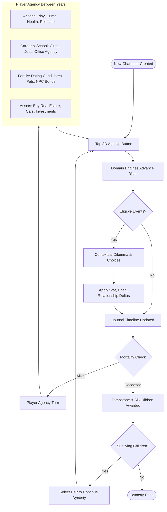

# Maisha (Life Simulator)

**Live your story. One year at a time.**

Maisha (Swahili for *life*) is an offline-first, single-player life simulation mobile game for Android in the BitLife / Age Sim genre. Players create a custom character and guide them year-by-year from birth through childhood, education, adult careers, love, finances, crime, fame, and mortality — continuing the family dynasty across generations as their surviving children.

Built specifically for modern Android with **Jetpack Compose and Material 3**, Maisha is optimized for mid-range and budget smartphones (~360dp width, Android 8.0+ / API 26 through API 35) while offering rich, adaptive layouts including navigation rails for tablets and foldables.

<p align="center">
  
  
  
  
  
  
</p>

---

## Table of Contents

- [Core Design Philosophy](#core-design-philosophy)
- [How a Life Plays](#how-a-life-plays)
- [Comprehensive Gameplay Systems](#comprehensive-gameplay-systems)
  - [1. Character Creation & Procedural 2D Portrait Engine](#1-character-creation--procedural-2d-portrait-engine)
  - [2. Infancy, Childhood & Teen Agency](#2-infancy-childhood--teen-agency)
  - [3. Deep Education, School Life & Clubs](#3-deep-education-school-life--clubs)
  - [4. University, Majors, Loans & Work-Study](#4-university-majors-loans--work-study)
  - [5. Careers, Corporate Ladders & Workplace Agency](#5-careers-corporate-ladders--workplace-agency)
  - [6. Talent Hub & Fame Pathways](#6-talent-hub--fame-pathways)
  - [7. Family, Interactive Matchmaking & Relationships](#7-family-interactive-matchmaking--relationships)
  - [8. Assets, Mortgages & Luxury Vehicles](#8-assets-mortgages--luxury-vehicles)
  - [9. Targeted Crime, Incarceration & Prison Life](#9-targeted-crime-incarceration--prison-life)
  - [10. Health, Illness & Medical Care](#10-health-illness--medical-care)
  - [11. Mortality, Tombstone Ribbons & Heir Succession](#11-mortality-tombstone-ribbons--heir-succession)
- [True Global Flavor (15 Countries)](#true-global-flavor-15-countries)
- [Architecture & Tech Stack](#architecture--tech-stack)
- [Audio & Haptics Feedback](#audio--haptics-feedback)
- [Getting Started & Development](#getting-started--development)
- [Documentation Index](#documentation-index)

---

## Core Design Philosophy

1. **Player Agency Over Passive Randomness:** Rather than simply tapping "Age Up" and reading passive popups, players make active decisions every year across 5 interactive tabs: Actions, Family & Relationships, Career & School, Assets, and Life.
2. **True Global Flavor (Not Flags Swapped on a US Template):** The game natively models 15 distinct nations (Kenya, Nigeria, South Africa, Egypt, USA, Canada, UK, France, Germany, India, Japan, Philippines, Indonesia, Brazil, Mexico). Each country features localized currencies, real name catalogs, exam systems (e.g., KCSE, WAEC, SAT, GCSE, Abitur, Baccalauréat), realistic transport modes (matatus, danfos, jeepneys), mobile money apps (M-Pesa, OPay, Venmo, Pix, UPI), holidays, and country-tailored economies.
3. **Offline-First & Privacy-Focused:** All narrative event packs (over 13 curated JSON files) and pure domain engines run 100% locally on the device with zero network requirement. Gameplay never stalls waiting for network responses.
4. **Clean Domain Purity:** Business logic lives entirely inside pure Kotlin domain engines free of Android framework dependencies (`Context`, `Bitmap`, `View`, `Compose`).

---

## How a Life Plays

A game begins by generating or customizing a new character with starting stats, country of origin, and a procedural illustrated 2D avatar. Each turn represents **one calendar year**:



---

## Comprehensive Gameplay Systems

### 1. Character Creation & Procedural 2D Portrait Engine
- **Single-Screen "New Life" Setup:** Fast, tactile character creation allowing players to choose their name, gender (Male, Female, Non-Binary), country, or roll random profiles.
- **Stat Budget Allocation:** Starting stats (Happiness, Health, Smarts, Looks, Karma) can be custom-allocated using a 140-point extra budget or quick presets (*Balanced*, *Genius*, *Athlete*, *Charmer*, *Hustler*). Starting stats fundamentally shape life outcomes, scholarship eligibility, and career gates.
- **100% Offline Procedural 2D Avatar (`ProceduralAvatarPortrait.kt`):** A custom Canvas rendering engine draws illustrated portraits dynamically. It composits facial structures, skin tones, hair textures and styles, expressive eyes, eyebrows, noses, mouths, facial hair (beards, goatees, mustaches), and accessories (glasses, hats, earrings, necklaces, collars).
- **Life Stage & Emotional Aging:** Avatars physically age from baby chubby cheeks to wrinkled elders with graying hair. Facial expressions dynamically react to player happiness, stress, depression, and severe illness. Minors under 14 are strictly protected from adult facial hair or eyeglasses.

### 2. Infancy, Childhood & Teen Agency
- **Infancy (Ages 0–2):** Exclusive baby interactions including *Cuddle Parents*, *Babble & Smile*, and *Throw Tantrums*. Free from debt stress and macroeconomic inflation spam.
- **Early Childhood (Ages 3–5):** Preschool exploration, playing with toys, bonding with pets, and early social learning.
- **School Age (Ages 6–15):** Children can ask parents for allowances, complete household chores, develop hobbies, play video game marathons, hang out at malls, sneak out after curfew, or confront neighborhood bullies.

### 3. Deep Education, School Life & Clubs
- **School Stages:** Primary School (Ages 6–12) & Secondary School (Ages 13–17/18) with country-specific exam titles (e.g. KCSE in Kenya, WAEC in Nigeria, GCSE in UK, SAT in US).
- **Study Effort Modes:** Players set annual study intensity: *Slacker* (low stress, dropping GPA), *Normal*, or *Grind* (high GPA, elevated stress).
- **School People Roster:** Every school generates dynamic NPCs with individual relationship bars: Classmates, Best Friend, Bully, Teachers, and School Crush.
- **Yearly School Activities:** One academic and one social action allowed per year, such as study groups, cramming at the library, asking teachers for assistance, social hangouts, confronting bullies, skipping class, or attending the annual school dance.
- **School Clubs:** Join Debate, Football/Soccer, Drama, Coding, or Music clubs. Progress through ranks (*Member* &rarr; *Officer* &rarr; *Captain*), choose practice intensity (*Light*, *Normal*, *Intense*), lead fundraisers, compete in cross-school rivalry matches, earn letter jackets, and secure college athletic/academic scholarships.
- **Gamified Exams & Discipline:** Take entrance exams with preparation mechanics, stress trade-offs, and risk-reward cheating options. Misbehavior triggers detention, principal appeals, and expulsion hearings.

### 4. University, Majors, Loans & Work-Study
- **7 Accredited Majors:** Computer Science, Law, Medicine, Business, Communications, Engineering, and Nursing.
- **Funding Options:** Cash upfront, merit-based Scholarships, or Student Loans with annual interest accrual and repayment schedules.
- **Campus Life Agency:** Attend campus mixers & Greek life, visit professor office hours, pull all-nighter exam crams, execute campus rivalry pranks, work campus student jobs, and complete corporate internships (Year 2+).
- **Honors & Career Fast-Tracks:** Graduate with *Cum Laude*, *Magna Cum Laude*, or *Summa Cum Laude* to unlock exclusive post-graduate career track offers (e.g. Software Engineer, Corporate Associate, Medical Resident, Law Associate).

### 5. Careers, Corporate Ladders & Workplace Agency
- **Dynamic Job Market:** Country-specific job pools with salary scales, degree prerequisites, and interview questions.
- **Corporate Ladder Progression:** Climb through 6 corporate tiers: *Entry-level* &rarr; *Mid-level* &rarr; *Senior* &rarr; *Lead* &rarr; *Director* &rarr; *Executive (C-Suite)*.
- **Workplace Roster & Agency (`WorkplaceRosterSheet.kt`):** Active jobs generate a Supervisor (with Strictness and Competence attributes) and diverse Coworkers. Players can:
  - *Schmooze Boss:* Flatter supervisors to improve standing and fast-track promotions.
  - *Ask for Raise / Promotion:* Pitch based on current performance rating.
  - *Collaborate:* Work alongside coworkers to boost company results.
  - *Pull Pranks:* Office pranks with a 35% backfire risk.
  - *Report to HR:* Report toxic or credit-stealing colleagues.
- **Workplace Hazards:** Burnout, Performance Improvement Plans (PIP), credit stealing, and corporate layoffs.
- **Part-Time & Side Hustles:** Student part-time jobs (ages 16+) with energy management, alongside youth and adult side hustles (freelance coding, streaming, craft sales).

### 6. Talent Hub & Fame Pathways
- **Specialized Talent Tracks:** Pro Athlete and Entertainment/Music pathways.
- **Skill Meters & Gigs:** Athleticism and Musical Talent bars. Engage in gym training, music lessons, street busking, and exhibition matches.
- **Fame Economy:** Idle fame decay, paparazzi interactions, public scandals, high-paying brand endorsements, and book deals.

### 7. Family, Interactive Matchmaking & Relationships
- **Diverse Relationships:** Parents, siblings, children, friends, enemies, romantic partners, spouses, and domestic pets.
- **Interactive Matchmaking Sheet (`DatingMatchSheet.kt`):** Replaces blind RNG dating. Browse candidate profile cards displaying age, occupation, Looks bar, Smarts bar, and a Crazy/Drama % rating with *Pass* or *Ask Out* buttons.
- **Relationship Progression:** Casual Dating &rarr; Exclusive &rarr; Engaged &rarr; Married.
- **Wedding Venues & Prenuptial Agreements:** Choose Courthouse, Local Venue, or Luxury Destination weddings. Negotiate prenuptial agreements, with partner reactions influenced by their Crazy and Karma attributes.
- **Anti-Exploit Protection:** `interactedTypesThisYear` prevents spamming the same interaction repeatedly on an NPC in a single year.
- **Comprehensive Pet Care:** Adopt dogs, cats, or exotic animals; schedule vet visits, training sessions, daily walks, and mourn their passing.

### 8. Assets, Mortgages & Luxury Vehicles
- **Real Estate & Mortgages:** Purchase apartments, suburban homes, country estates, or penthouses. Finance through 30-year amortized mortgages with 20–50% down payments. Properties accrue maintenance costs, appreciate with local market trends, and resolve home equity upon sale.
- **Luxury Vehicles:** Buy cars, speedboats, yachts, and private jets. Features authentic vehicle depreciation curves and monthly upkeep. Unlocks exclusive leisure actions like *Yacht Days* and *Private Jet Trips*.
- **Investments & Crypto:** Invest in high-yield savings, index funds, speculative stocks, or cryptocurrencies.
- **Wills & Testaments:** Draft an estate plan: leave assets to a spouse, distribute equally among children, name a favorite child as sole heir, or donate to charity.

### 9. Targeted Crime, Incarceration & Prison Life
- **Targeted Crime Specializations:** Attempt *Pickpocketing*, *Shoplifting*, *Grand Theft Auto (GTA)*, *Burglary*, or *Armed Bank Heists* with varying risk/reward ratios.
- **Legal System & Trials:** Arrested characters can hire Public Defenders or high-priced Elite Defense Attorneys to avoid conviction or reduce prison sentences.
- **Incarceration & Prison Yard:** Inmates manage gang standing, work prison jobs, petition for parole, or plan elaborate prison breaks.

### 10. Health, Illness & Medical Care
- **Dynamic Medical System:** Characters can contract common ailments (flu, food poisoning), acute emergencies, or chronic conditions (hypertension, asthma, depression).
- **Healthcare Tiers:** Choose Public Community Clinics, Private Specialists, or Alternative Medicine Healers.
- **Wellness & Habits:** Diet regimes (Mediterranean, Keto, Vegan), plastic surgery procedures, mental health therapy, and gym memberships.

### 11. Mortality, Tombstone Ribbons & Heir Succession
- **Mortality Calculation:** Annual death probabilities scale realistically based on health deterioration, old age (80+), lifestyle hazards, or fatal accidents.
- **BitLife-Style Silk-Sash Tombstone Ribbons (`LifeArchetypeEngine`):** Upon death, characters are immortalized with an epitaph and an exclusive silk ribbon sash:
  - 🏅 **Loaded:** Massive accumulated wealth.
  - 🎓 **Academic:** High GPA, multiple degrees, intellectual achievements.
  - 🎭 **Fame Icon:** Global celebrity or sports legend status.
  - 🕊️ **Saint:** Flawless karma, selfless charity, and loving family bonds.
  - 👑 **Family Anchor:** Raised a large, happy family across generations.
  - 💼 **Workaholic:** C-Suite corporate powerhouse.
  - 🕵️ **Cunning:** Master criminal who pulled off high-stakes heists.
  - ⚡ **Scandalous:** Chronic notoriety, prison stints, and public drama.
  - 🍃 **Mediocre:** A quiet, ordinary, unremarkable life.
- **Dynasty Succession (`HeirSelectionScreen.kt`):** Seamlessly continue playing as one of your adult children, inheriting cash, properties, and the family legacy across generations.

---

## True Global Flavor (15 Countries)

Maisha provides deep localization across **15 natively supported nations**:

| Country | Code | Currency | Common Transport | Exam System | Banking / Money App |
|:---|:---:|:---:|:---|:---|:---|
| **Kenya** | `KE` | KSh | Matatu | KCPE / KCSE | M-Pesa |
| **Nigeria** | `NG` | ₦ | Danfo | WAEC / NECO | OPay / PalmPay |
| **South Africa** | `ZA` | R | Minibus Taxi | National Senior Certificate (Matric) | Capitec Bank App |
| **Egypt** | `EG` | E£ | Microbus | Thanaweya Amma | InstaPay / Vodafone Cash |
| **United States** | `US` | $ | Subway / Yellow Cab | SAT / ACT | Venmo / Cash App |
| **Canada** | `CA` | CA$ | Streetcar / Transit Bus | Provincial Diplomas | Interac e-Transfer |
| **United Kingdom** | `GB` | £ | Double-decker Bus / Tube | GCSE / A-Levels | Monzo / Revolut |
| **France** | `FR` | € | Métro | Diplôme National / Baccalauréat | Lydia |
| **Germany** | `DE` | € | U-Bahn / S-Bahn | Abitur | N26 / Sparkasse App |
| **India** | `IN` | ₹ | Auto Rickshaw | CBSE / ICSE Boards | UPI (PhonePe / GPay) |
| **Japan** | `JP` | ¥ | Shinkansen / Commuter Train | Kyotsu Test (Common Test) | PayPay |
| **Philippines** | `PH` | ₱ | Jeepney / Tricycle | DepEd NAT | GCash / Maya |
| **Indonesia** | `ID` | Rp | Angkot / Ojek | Ujian Tulis Berbasis Komputer (UTBK) | GoPay / OVO |
| **Brazil** | `BR` | R$ | Ônibus / Metrô | ENEM (Exame Nacional) | Pix (Nubank) |
| **Mexico** | `MX` | MX$ | Colectivo / Metrobus | EXANI / CENEVAL | Coppel / BBVA México |

Event texts use dynamic tokens like `{transportMode}`, `{secondaryExam}`, `{moneyApp}`, and `{greeting}` so that stories read authentically anywhere in the world.

---

## Architecture & Tech Stack

```
┌────────────────────────────────────────────────────────┐
│                  Jetpack Compose UI                    │
│   LifeScreen | ActionsScreen | CareerScreen | Family   │
│   LeftNavRail | InsetCardContainer | 3D AgeUpButton    │
└───────────────────────────┬────────────────────────────┘
                            │ StateFlow
┌───────────────────────────▼────────────────────────────┐
│                Hilt ViewModels (MVVM)                  │
│       LifeViewModel, CharacterCreationViewModel        │
└───────────────────────────┬────────────────────────────┘
                            │
┌───────────────────────────▼────────────────────────────┐
│            GameEngine (Central Orchestrator)           │
├────────────────────────────────────────────────────────┤
│ Pure Kotlin Domain Engines:                            │
│  • EducationEngine       • CareerEngine                │
│  • FinanceEngine         • RelationshipEngine          │
│  • HealthEngine          • CrimeEngine                 │
│  • LeisureEngine         • BusinessEngine              │
│  • PoliticsEngine        • RelocationEngine            │
│  • MilestoneEngine       • LegacyEngine ...            │
└───────────────────────────┬────────────────────────────┘
                            │
┌───────────────────────────▼────────────────────────────┐
│               Data & Persistence Layer                 │
│  • Room Database (3 Character Save Slots + Entities)   │
│  • DataStore Preferences (Audio, Haptics, Settings)    │
│  • EventRepository (13+ Narrative JSON Packs)          │
│  • Google Play Games Services v2 (Cloud & Boards)      │
└────────────────────────────────────────────────────────┘
```

- **100% Kotlin 2.0+:** Targeting Java 17 bytecode.
- **UI Framework:** Jetpack Compose + Material 3 with adaptive layouts (`LeftNavRail` and `BottomNav`).
- **Domain Purity:** Domain engines accept immutable data models and return updated copies without touching Android `Context` or Compose.
- **Persistence:** Multi-slot Room database storing deep game state as versioned JSON blobs for seamless migration resilience.
- **Background Tasks:** AndroidX WorkManager for contextual daily retention reminders.
- **Cloud & Social:** Google Play Games Services v2 cloud save snapshots (`SnapshotsClient`) and global leaderboards (Net Worth, Longest Life, Generations, Happiness).

---

## Audio & Haptics Feedback

Maisha features a custom tactile audio and vibration system configured in `FeedbackManager.kt`:
- **16-bit 44.1kHz Synthesized Audio:** Custom sound effects for *Age Up*, *Button Tap*, *Money Gain*, *Purchase*, *Positive Event*, *Negative Event*, *Achievement Unlock*, and *Death*.
- **Multi-Waveform Haptic Patterns:** Distinct tactile vibration pulses for button presses, major life milestones, and negative life shocks.

---

## Getting Started & Development

### Prerequisites
- Android Studio (Ladybug 2024.2.1+ or newer)
- JDK 17
- Android SDK 35 (`minSdk 26`, `targetSdk 35`)

### Common Gradle Commands

```bash
# Build debug APK
./gradlew assembleDebug

# Install debug build on connected device/emulator
./gradlew :app:installDebug

# Run domain and content unit tests
./gradlew testDebugUnitTest

# Run specific engine unit test
./gradlew :app:testDebugUnitTest --tests "com.maisha.game.domain.EducationEngineTest"
```

---

## Documentation Index

All project documentation is consolidated within the [`docs/`](./) directory:

- [**GAME_OVERVIEW.md**](GAME_OVERVIEW.md) — Master game design reference, formulas, and deep mechanics breakdown.
- [**GEMINI.md**](GEMINI.md) — Technical context, domain engine responsibilities, and AI assistant guidelines.
- [**AI_CONTINUITY_PROMPT.md**](AI_CONTINUITY_PROMPT.md) — Maintainer continuity prompt, commit timeline, and system inventory.
- [**EVENTS_SYSTEM.md**](EVENTS_SYSTEM.md) — Narrative event engine schema, tag reference, and authoring guide.
- [**PRIVACY_POLICY.md**](PRIVACY_POLICY.md) — Offline-first privacy policy, flavor APIs, and AdMob data disclosure.
