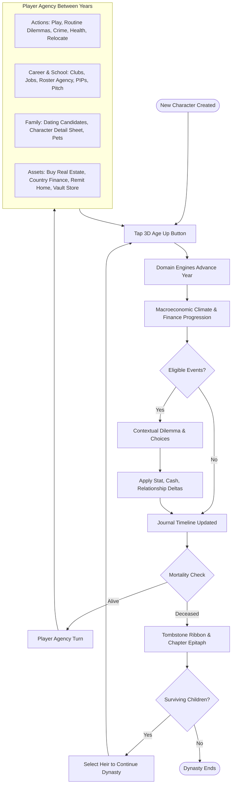

# Maisha (Life Simulator)

**Live your story. One year at a time.**

Maisha (Swahili for *life*) is an offline-first, single-player life simulation mobile game for Android in the BitLife / Age Sim genre. Players create a custom character and guide them year-by-year from birth through childhood, education, adult careers, love, finances, crime, fame, and mortality — continuing the family dynasty across generations as their surviving children.

Built specifically for modern Android with **Jetpack Compose and Material 3**, Maisha is optimized for mid-range and budget smartphones (~360dp width, Android 8.0+ / API 26 through API 35) while offering rich, adaptive layouts including navigation rails for tablets and foldables.

<p align="center">
  
  
  
  
  
  
</p>

---

## Table of Contents

- [Core Design Philosophy](#core-design-philosophy)
- [How a Life Plays](#how-a-life-plays)
- [Comprehensive Gameplay Systems](#comprehensive-gameplay-systems)
  - [1. Character Creation & Procedural 2D Portrait Engine](#1-character-creation--procedural-2d-portrait-engine)
  - [2. Infancy, Childhood & Teen Agency](#2-infancy-childhood--teen-agency)
  - [3. Deep Education, School Life & Clubs](#3-deep-education-school-life--clubs)
  - [4. University, Majors, Loans & Work-Study](#4-university-majors-loans--work-study)
  - [5. Careers, Corporate Ladders & Workplace Agency](#5-careers-corporate-ladders--workplace-agency)
  - [6. Talent Hub & Fame Pathways](#6-talent-hub--fame-pathways)
  - [7. Family, Interactive Matchmaking & Character Sheets](#7-family-interactive-matchmaking--character-sheets)
  - [8. Living Social Ecosystem & Generational Memory](#8-living-social-ecosystem--generational-memory)
  - [9. Routine Micro-Dilemmas & Snap Decisions](#9-routine-micro-dilemmas--snap-decisions)
  - [10. Dynamic Chapter Titles & Evocative Epitaphs](#10-dynamic-chapter-titles--evocative-epitaphs)
  - [11. 15-Country Personal Finance, Economy & Dynasty Vault](#11-15-country-personal-finance-economy--dynasty-vault)
  - [12. Targeted Crime, Incarceration & Police Heat](#12-targeted-crime-incarceration--police-heat)
  - [13. Health, Wellness & Medical Care](#13-health-wellness--medical-care)
  - [14. Mortality, Tombstone Ribbons & Heir Succession](#14-mortality-tombstone-ribbons--heir-succession)
- [True Global Flavor (15 Countries)](#true-global-flavor-15-countries)
- [Architecture & Tech Stack](#architecture--tech-stack)
- [Audio & Haptics Feedback](#audio--haptics-feedback)
- [Getting Started & Development](#getting-started--development)
- [Documentation Index](#documentation-index)

---

## Core Design Philosophy

1. **Player Agency Over Passive Randomness:** Rather than simply tapping "Age Up" and reading passive popups, players make active decisions every year across 5 interactive tabs: Actions, Family & Relationships, Career & School, Assets, and Life.
2. **True Global Flavor (Not Flags Swapped on a US Template):** The game natively models 15 distinct nations (Kenya, Nigeria, South Africa, Egypt, USA, Canada, UK, France, Germany, India, Japan, Philippines, Indonesia, Brazil, Mexico). Each country features localized currencies, real name catalogs, exam systems (e.g., KCSE, WAEC, SAT, GCSE, Abitur, Baccalauréat), realistic transport modes (matatus, danfos, jeepneys), mobile money apps (M-Pesa, OPay, Venmo, Pix, UPI), holidays, localized financial instruments, and country-tailored economies.
3. **Offline-First & Privacy-Focused:** All narrative event packs (19 curated JSON files) and pure domain engines run 100% locally on the device with zero network requirement. Gameplay never stalls waiting for network responses.
4. **Clean Domain Purity:** Business logic lives entirely inside pure Kotlin domain engines free of Android framework dependencies (`Context`, `Bitmap`, `View`, `Compose`).

---

## How a Life Plays

A game begins by generating or customizing a new character with starting stats, country of origin, and a procedural illustrated 2D avatar. Each turn represents **one calendar year**:



---

## Comprehensive Gameplay Systems

### 1. Character Creation & Procedural 2D Portrait Engine
- **Single-Screen "New Life" Setup:** Fast, tactile character creation featuring a bold game header ("NEW LIFE"), quick-roll profile dice action (`AppIcons.Dice`), gender selection with custom vector icons (Male, Female, Non-Binary), and centered baby avatar preview with a layered halo backdrop.
- **Country Opportunity Card:** Live preview card displaying country flag, local currency symbol, authentic commute transport mode (`{transportMode}`), and secondary exam qualification (`{secondaryExam}`).
- **Starting Aptitude Archetypes (`StartingStatArchetype`):** Select quick stat presets (*Balanced*, *Prodigy*, *Athlete*, *Charmer*, *Hustler*, *Custom*) with a live 4-stat meters HUD (Health, Happiness, Smarts, Looks) or custom allocate stats using the fine-tune slider budget. Starting stats fundamentally shape life outcomes, scholarship eligibility, and career gates.
- **100% Offline Procedural 2D Avatar (`ProceduralAvatarPortrait.kt`):** A custom Canvas rendering engine draws illustrated portraits dynamically. It composits facial structures, skin tones, hair textures and styles, expressive eyes, eyebrows, noses, mouths, facial hair (beards, goatees, mustaches), and accessories (glasses, hats, earrings, necklaces, collars).
- **Life Stage & Emotional Aging:** Avatars physically age from baby chubby cheeks to wrinkled elders with graying hair. Facial expressions dynamically react to player happiness, stress, depression, and severe illness. Minors under 14 are strictly protected from adult facial hair or eyeglasses.

### 2. Infancy, Childhood & Teen Agency
- **Infancy (Ages 0–2):** Exclusive baby interactions including *Cuddle Parents*, *Babble & Smile*, and *Throw Tantrums*. Free from debt stress, taxes, and macroeconomic inflation spam.
- **Early Childhood (Ages 3–5):** Preschool exploration, playing with toys, bonding with pets, and early social learning.
- **Childhood Aptitude Seeds (Ages 4–10):** Characters explore obsessions across 5 tracks: *Athletics*, *Arts & Music*, *Tech & Tinkering*, *Academics*, and *Street Hustle*. Practicing hobbies builds mastery scores and stat boosts that carry into high school clubs, university scholarships, and adult careers.
- **School Age (Ages 6–15):** Children can ask parents for allowances, complete household chores, develop hobbies, play video game marathons, hang out at malls, sneak out after curfew, or confront neighborhood bullies.
- **Parental Trust & Curfews:** Dynamic curfew hours (default 9:00 PM). High trust allows requesting later curfews (up to 11:00 PM). Sneaking out risks grounding, trust penalties, and curfew tightening to 8:00 PM.

### 3. Deep Education, School Life & Clubs
- **School Stages:** Primary School (Ages 6–12) & Secondary School (Ages 13–17/18) with country-specific exam titles (e.g. KCSE in Kenya, WAEC in Nigeria, GCSE in UK, SAT in US).
- **Study Effort Modes:** Players set annual study intensity: *Slacker* (low stress, dropping GPA), *Normal*, or *Grind* (high GPA, elevated stress).
- **School People Roster:** Every school generates dynamic NPCs with individual relationship bars: Classmates, Best Friend, Bully, Teachers, and School Crush.
- **Yearly School Activities:** One academic and one social action allowed per year, such as study groups, cramming at the library, asking teachers for assistance, social hangouts, confronting bullies, skipping class, or attending the annual school dance.
- **School Clubs:** Join Debate, Football/Soccer, Drama, Coding, or Music clubs. Progress through ranks (*Member* &rarr; *Officer* &rarr; *Captain*), choose practice intensity (*Light*, *Normal*, *Intense*), lead fundraisers, compete in cross-school rivalry matches, earn letter jackets, and secure college athletic/academic scholarships. Club leaders access tactical agency: strategy sessions (`leadClubStrategy`) and junior mentorship (`mentorClubJunior`).
- **Gamified Exams & Discipline:** Take entrance exams with preparation mechanics, stress trade-offs, and risk-reward cheating options. Misbehavior triggers detention, principal appeals, and expulsion hearings.

### 4. University, Majors, Loans & Work-Study
- **7 Accredited Majors:** Computer Science, Law, Medicine, Business, Communications, Engineering, and Nursing.
- **Funding Options:** Cash upfront, merit-based Scholarships, or Student Loans with annual interest accrual and repayment schedules.
- **Campus Life Agency:** Attend campus mixers & Greek life, visit professor office hours, pull all-nighter exam crams, execute campus rivalry pranks, work campus student jobs, and complete corporate internships (Year 2+).
- **Honors & Career Fast-Tracks:** Graduate with *Cum Laude*, *Magna Cum Laude*, or *Summa Cum Laude* to unlock exclusive post-graduate career track offers (e.g. Software Engineer, Corporate Associate, Medical Resident, Law Associate).

### 5. Careers, Corporate Ladders & Workplace Agency
- **Another Life Style Career Dashboard:** High-impact Career Hero Card featuring custom vector role badges, corporate tier stepper (*Entry* -> *Mid* -> *Senior* -> *Lead* -> *Director* -> *Executive*), salary + annual raise projection pill, performance meter with color states, and burnout/stress warning bar.
- **Dynamic Job Market & Opportunities:** Real opportunity cards displaying requirement badges (Degree, Smarts, Looks, Experience), salary range, and punchy 2-question interview mini-checks before hiring.
- **Workplace Roster & Tactile Agency (`WorkplaceRosterSheet.kt`):** Active jobs generate a Supervisor (with Strictness and Competence attributes) and diverse Coworkers. Players can:
  - *Schmooze Boss:* Flatter supervisors to improve standing and fast-track promotions.
  - *Ask for Raise / Pitch Promotion:* Pitch based on current performance rating.
  - *Collaborate:* Work alongside coworkers to boost company results.
  - *Pull Pranks:* Office pranks with a 35% backfire risk.
  - *Report to HR:* Report toxic or credit-stealing colleagues.
  - *Pitch Project / Mentorship:* Innovate on deliverables or request senior guidance.
- **Workplace Hazards & PIP Counter-Moves:** Performance Improvement Plans (PIPs), credit stealing, burnout, and corporate layoffs. Dedicated `PipAlertCard` provides interactive recovery via `workPipDeliverable` (+20% performance, guaranteed clearance) and `rebutPipWithHR` (HR appeal).
- **Interactive Entrepreneurship & Startups (`BusinessProgressionCard.kt`):**
  - *5-Tier Company Lifecycle:* Progress from `Bootstrap` -> `Seed Stage` -> `Growth Stage` -> `Expansion` -> `Enterprise` based on valuation milestones.
  - *Startup Dashboard:* Live Revenue vs. Burn Rate indicator pill, Equity Ownership %, Company Valuation, Team Morale, and Product Quality gauges.
  - *Tactile Founder Agency:* Launch new products and services, scale headcount, pivot industry, raise outside venture capital (diluting equity for cash injections), sell company for equity payout, or liquidate assets.
- **Political Campaigns & Public Office (`PoliticalCampaignBoard.kt`):**
  - *Elected Offices:* Run for City Mayor, State Governor, or Head of State / President.
  - *Campaign Progression:* Select signature campaign agendas (*Infrastructure*, *Education*, *Healthcare*, *Tax Relief*, *Anti-Corruption*), track polling support vs. opponent, manage campaign war chest funds, hold grassroots rallies, fundraise donors, and cast ballots on Election Day.
  - *Governance Dashboard:* Active officeholders manage 4-year term countdowns, public approval meters, and controversy heat. Deliver state addresses, enact signature legislative reforms, manage political scandals, or resign from office.
- **Part-Time & Side Hustles:** Student part-time jobs (ages 16+) with energy management, alongside youth and adult side hustles (freelance coding, streaming, craft sales).

### 6. Fame, Creator Economy & Talent Hub
- **5-Tier Fame Ribbon (`FameSocialMediaBoard.kt`):** Visual tier ribbon progression (*Unknown*, *Rising Star*, *Micro Influencer*, *Viral Celeb*, *Global Icon*) with verified creator badge styling.
- **Creator Economy Agency:**
  - *Audience & Burnout Meters:* Balance follower reach, Audience Trust (0-100), and Creator Burnout (0-100).
  - *Interactive Creator Actions:* Post viral content, negotiate country-scaled brand sponsorship deals, collaborate with fellow creators, take digital detox mental breaks, and monetize ad streams.
  - *Cancel Culture & Drama PR:* React to public controversies and viral drama by taking accountability or pushing back to restore reputation.
- **Specialized Talent Tracks:** Pro Athlete and Entertainment/Music pathways.
- **Skill Meters & Gigs:** Athleticism and Musical Talent bars. Engage in gym sessions, sports drills, music lessons, stage practice, street busking, and exhibition matches.
- **Fame Economy:** Idle fame decay, paparazzi interactions, public scandals, high-paying brand endorsements, and book deals.

### 7. Family, Interactive Matchmaking & Character Sheets
- **BitLife-Style Character Detail Sheet (`PersonDetailSheet.kt`):**
  - Character header with 64dp `ProceduralAvatarPortrait` synced live to mood and temperament (`Expression.ANGRY`, `SAD`, `HAPPY`, `SURPRISED`, or `NEUTRAL`).
  - Role and clique badge pills (Spouse, Parent, Sibling, Child, Rival, Ally) with marital stage chips.
  - Dual color-coded stat bars for Relationship Level and Temperament/Drama (`member.crazy`).
  - Reactive speech and thought quote banners updating immediately after interactions, accompanied by floating delta feedback pills (`+Bond`, `-Bond`, cash deltas).
  - Tactile 2-column grid of custom vector icon interaction tiles (Spend Time, Compliment, Gift, Deep Talk, Ask Money, Argue, Prank, Propose, Break Up / Divorce) with explicit "Used" status indicators for `interactedTypesThisYear`.
- **Interactive Matchmaking (`DatingMatchSheet.kt`):** Browse candidate profile cards displaying age, occupation, national flag, salary tier badges (Modest, Middle Class, High Earner, Wealthy), and Looks, Smarts, Drama, and Finances meters with tactile *Pass* or *Ask Out* buttons.
- **Relationship Progression:** Casual Dating &rarr; Exclusive &rarr; Engaged &rarr; Married.
- **Wedding Venues & Prenuptial Agreements:** Choose Courthouse, Local Venue, or Luxury Destination weddings. Negotiate prenuptial agreements, with partner reactions influenced by their Crazy and Karma attributes.
- **Comprehensive Pet Care (`PetDetailSheet.kt`):** Adopt dogs, cats, or exotic animals; species cards with dual bond/health meters, tactile Feed, Play, and Vet care actions, and mourning sequences.

### 8. Living Social Ecosystem & Generational Memory
- **Recurring Social Entities (`SocialEcosystemEngine.kt`):** NPCs and lineages form a living social ecosystem:
  - *Rivals & Nemeses:* Persistent rivals who challenge promotions, sabotage deals, or mock the player, carrying emotional grudges across years.
  - *Mentors & Benefactors:* Seasoned benefactors providing insider career tips, financial seed capital, and emergency assistance.
  - *Family Feuds & Alliances:* Deep generational feuds or stalwart family alliances that persist across decades and can be inherited by designated heirs through `LegacyEngine`.
- **Neighborhood Standing & Memory:** Community reputation (wealth, scandal, generosity, or past family scandals) subtly shapes how NPCs react, how job and business deals open or close, and how heirs are received upon succession.

### 9. Routine Micro-Dilemmas & Snap Decisions
- **Everyday Dilemma Engine (`RoutineDilemmaEngine.kt`):** Ordinary years feature snappy micro-dilemmas tied to active activities and life stages:
  - *Morning Commute:* Offering a seat, navigating fare spikes, or catching shortcut taxis via `{transportMode}`.
  - *Study & Work Crunch:* Covering a struggling colleague, coffee runs, or all-nighter project deliverables.
  - *Weekend Splurges & Family Dinners:* Splitting group bills, tipping dilemmas, handling awkward family dinner discussions, or haggling at local markets.
- **Crisp Trade-Offs:** Fast-resolving choices with immediate consequences across stats, cash, relationships, or police heat.

### 10. Dynamic Chapter Titles & Evocative Epitaphs
- **Live Era & Chapter Titles (`LifeArchetypeEngine.kt`):** Every character dynamically receives an evocative chapter title as they age, reflecting their current life stage, dominant traits, major milestones, or notorious streaks (e.g. *The Curious Prodigy*, *The Corporate Climber*, *The Shadow Syndicate*, *The Revered Matriarch*).
- **Evocative Obituaries & Legacy Stamps:** Enriched end-of-life epitaphs and multi-generational legacy stamps ensure that two characters with identical net worth or lifespan feel distinct based on their actual life choices and who they impacted.

### 11. 15-Country Personal Finance, Economy & Dynasty Vault
- **Dynamic Credit Score (300–850):** Driven by on-time debt payments, payment streaks, shortfall defaults (-35), debt-to-income (DTI) drag, and criminal convictions (-20 per felony). Gates mortgage qualification (minimum 500 score required) and sets tiered down-payment requirements (10% to 40%) and APR interest rates (5.5% to 12.0%).
- **Transparent Annual Cash-Flow Breakdown (`computeAnnualCashFlow`):** Itemized ledger computing Gross Income (primary salary, part-time & side gigs, rental yields, investment/savings dividends, retirement pensions, business dividends, content revenue) minus Deductions (progressive income tax, living costs, mortgage service, student loan repayment, asset maintenance, child support, pet care) to project net annual surplus or deficit.
- **4-State Macroeconomic Cycle:** Simulates fluctuating national economic climates (`BOOM`, `STEADY`, `INFLATION_SURGE`, `RECESSION`). Shifts property valuations, portfolio returns, living costs, upkeep multipliers, and company downsizing/layoff frequencies across in-game years.
- **Banking, Savings & Junior Trust:** Distinguishes liquid wallet cash from interest-bearing savings and investment portfolios. Minor characters (ages 0–17) can deposit gift money into a Junior Trust Piggy Bank which automatically unlocks and transfers into liquid funds upon reaching adulthood at age 18.
- **15 Country-Authentic Financial Instruments (`CountryFinanceSheet.kt`):** Deep localized financial products across all 15 countries with authentic names, yield rates, risk ratings, and minimum deposits:
  - *Kenya (KE):* SACCO Dividends (8–14% APY, Tax Exempt) and mobile overdraft buffer (Safaricom Fuliza up to 15,000 KES, protecting health and happiness from living cost shortfalls).
  - *Nigeria (NG):* Federal Government Treasury Bills (10–18% APY, Zero Risk).
  - *South Africa (ZA):* Stokvel Mutual Society (6–12% APY, Low Risk).
  - *Egypt (EG):* High-Yield Certificate of Deposit (12–22% APY, Low Risk).
  - *United States (US):* 401(k) / Roth IRA Index Fund (7–11% APY, Tax Deferred).
  - *Canada (CA):* Tax-Free Savings Account (TFSA) / RRSP (5–9% APY, Tax Free).
  - *United Kingdom (GB):* Stocks & Shares ISA (5–10% APY, Tax Free).
  - *France (FR):* Livret A Regulated Savings (3–5% APY, Tax Exempt).
  - *Germany (DE):* Festgeld Term Deposit (3–5% APY, Zero Risk).
  - *India (IN):* Public Provident Fund (PPF) (7–9% APY, Sovereign Guaranteed).
  - *Japan (JP):* Nippon Individual Savings Account (NISA) (4–8% APY, Tax Free).
  - *Philippines (PH):* Pag-IBIG MP2 Government Savings (6–9% APY, Tax Free).
  - *Indonesia (ID):* Deposito Berjangka / Arisan (5–8% APY, Low Risk).
  - *Brazil (BR):* Tesouro Direto / Selic (9–14% APY, Zero Risk).
  - *Mexico (MX):* Cetes Directo Government Treasury (8–12% APY, Zero Risk).
- **Relocation FX & International Remittances (`RemittanceSheet.kt`):** Cross-border relocation through `RelocationEngine` converts liquid, savings, and trust funds via `EconomyScaler.convertCurrency` PPP ratios, liquidates local instruments, and initializes a clean 600 credit baseline. Expatriate characters can send remittances back home via `RemittanceSheet` with real-time currency conversion, strengthening family relationships (+5 to +18), character Happiness, and Karma.
- **Google Play Billing Store (`DynastyVaultStoreSheet.kt`):** Injected `@Singleton BillingManager` with `billing-ktx` 7.1.1, auto-reconnection, `onResume` purchase recovery, and full offline fallback:
  - *Dynasty Cash Vouchers:* Consumables (`dynasty_cash_starter`, `dynasty_cash_fortune`, `dynasty_cash_tycoon`) scaled dynamically at redemption via `EconomyScaler.scaleAmount` per active character country.
  - *Permanent Unlocks:* Ad-Free Experience (`unlock_ad_free` disabling AdMob interstitials and banners) and Creator Pass (`unlock_creator_pass` granting custom starting stats, unlimited re-rolls, and golden dynasty badge).
- **Tactile Financial Dashboard (`AssetsScreen.kt`):** `FinanceSummaryCard` at the top of the assets tab displaying Net Worth, Liquid Cash, Net Cash Flow (+/-), Credit Rating meter, and Economic Climate chip, backed by tactile bottom sheets: `CashFlowLedgerSheet`, `DebtLiabilitiesSheet`, `CountryFinanceSheet`, `RemittanceSheet`, and `DynastyVaultStoreSheet`.
- **Luxury Assets & Preventative Servicing:** Houses, cars, speedboats, yachts, and private jets with country-scaled pricing, depreciation, and upkeep. Preventative servicing grants annual immunity to wear and critical breakdowns.

### 12. Targeted Crime, Incarceration & Police Heat
- **Targeted Crime Specializations:** Attempt *Pickpocketing*, *Shoplifting*, *Grand Theft Auto (GTA)*, *Burglary*, or *Armed Bank Heists* with varying risk/reward ratios.
- **Target Casing & Police Heat:** Pre-casing targets (`caseTarget`) grants a +20% success boost on the subsequent crime at the cost of +5 Heat. Dynamic `heatLevel` [0–100] meter with color-coded risk bar; active penalties on criminal operations; countermeasures via `layLow` and `bribeInformant`.
- **Legal System & Trials:** Arrested characters can hire Public Defenders or high-priced Elite Defense Attorneys to avoid conviction or reduce prison sentences.
- **Incarceration & Prison Yard:** Inmates manage gang standing, work prison jobs, petition for parole, or plan elaborate prison breaks.

### 13. Health, Wellness & Medical Care
- **Dynamic Medical System:** Characters can contract common ailments (flu, food poisoning), acute emergencies, or chronic conditions (hypertension, asthma, depression).
- **Healthcare Tiers:** Choose Public Community Clinics, Private Specialists, or Alternative Medicine Healers.
- **Wellness & Habits:** Diet regimes (Mediterranean, Keto, Vegan), plastic surgery procedures, mental health therapy, and gym memberships.

### 14. Mortality, Tombstone Ribbons & Heir Succession
- **Mortality Calculation:** Annual death probabilities scale realistically based on health deterioration, old age (80+), lifestyle hazards, or fatal accidents.
- **Commemorative Monument Dossier (`LifeSummaryScreen.kt`):** Upon death, characters are immortalized with an arched stone slab monument, top Silk Sash Life Ribbon Banner with custom vector tombstone emblem (`AppIcons.Tombstone`), gilded medallion oval holding a peaceful `ProceduralAvatarPortrait`, carved lifetime metrics strip (Lifetime Net Worth, Pinnacle Career, Family Lineage), cause-of-death plaque, and evocative narrative epitaph.
- **BitLife-Style Silk-Sash Tombstone Ribbons (`LifeArchetypeEngine`):** Characters earn an exclusive silk ribbon sash based on their dominant life arc:
  - [Loaded]: Massive accumulated wealth.
  - [Academic]: High GPA, multiple degrees, intellectual achievements.
  - [Fame Icon]: Global celebrity or sports legend status.
  - [Saint]: Flawless karma, selfless charity, and loving family bonds.
  - [Family Anchor]: Raised a large, happy family across generations.
  - [Workaholic]: C-Suite corporate powerhouse.
  - [Cunning]: Master criminal who pulled off high-stakes heists.
  - [Scandalous]: Chronic notoriety, prison stints, and public drama.
  - [Mediocre]: A quiet, ordinary, unremarkable life.
- **Hero-Grade Heir Continuity CTA:** A prominent "Continue as Heir" CTA button directly below the monument allows immediate succession into surviving lineage.
- **Rich Heir Succession Dossier (`HeirSelectionScreen.kt` & `LegacyEngine.kt`):**
  - Selectable heir candidate cards with 56dp `ProceduralAvatarPortrait` synced to relationship bond.
  - Transparent estate inheritance share calculations (exact cash amount and estate percentage share based on will or equal division).
  - Four key stat meters (Health, Smarts, Looks, Happiness) and relationship bond percentage.
  - Tactile "Choose Heir" action button with crown vector emblem (`AppIcons.HeirCrown`).

---

## True Global Flavor (15 Countries)

Maisha provides deep localization across **15 natively supported nations**:

| Country | Code | Currency | Common Transport | Exam System | Banking / Money App | Financial Instrument |
|:---|:---:|:---:|:---|:---|:---|:---|
| **Kenya** | `KE` | KSh | Matatu | KCPE / KCSE | M-Pesa | SACCO Dividends & Fuliza Overdraft |
| **Nigeria** | `NG` | ₦ | Danfo | WAEC / NECO | OPay / PalmPay | FGN Treasury Bills |
| **South Africa** | `ZA` | R | Minibus Taxi | National Senior Certificate (Matric) | Capitec Bank App | Stokvel Mutual Society |
| **Egypt** | `EG` | E£ | Microbus | Thanaweya Amma | InstaPay / Vodafone Cash | High-Yield Certificate of Deposit |
| **United States** | `US` | $ | Subway / Yellow Cab | SAT / ACT | Venmo / Cash App | 401(k) / Roth IRA Index Fund |
| **Canada** | `CA` | CA$ | Streetcar / Transit Bus | Provincial Diplomas | Interac e-Transfer | TFSA / RRSP Mutual Funds |
| **United Kingdom** | `GB` | £ | Double-decker Bus / Tube | GCSE / A-Levels | Monzo / Revolut | Stocks & Shares ISA |
| **France** | `FR` | € | Métro | Diplôme National / Baccalauréat | Lydia | Livret A Regulated Savings |
| **Germany** | `DE` | € | U-Bahn / S-Bahn | Abitur | N26 / Sparkasse App | Festgeld Term Deposit |
| **India** | `IN` | ₹ | Auto Rickshaw | CBSE / ICSE Boards | UPI (PhonePe / GPay) | Public Provident Fund (PPF) |
| **Japan** | `JP` | ¥ | Shinkansen / Commuter Train | Kyotsu Test (Common Test) | PayPay | NISA Tax-Free Account |
| **Philippines** | `PH` | ₱ | Jeepney / Tricycle | DepEd NAT | GCash / Maya | Pag-IBIG MP2 Government Savings |
| **Indonesia** | `ID` | Rp | Angkot / Ojek | UTBK | GoPay / OVO | Deposito Berjangka / Arisan |
| **Brazil** | `BR` | R$ | Ônibus / Metrô | ENEM (Exame Nacional) | Pix (Nubank) | Tesouro Direto / Selic |
| **Mexico** | `MX` | MX$ | Colectivo / Metrobus | EXANI / CENEVAL | Coppel / BBVA México | Cetes Directo Government Treasury |

Event texts use dynamic tokens like `{transportMode}`, `{secondaryExam}`, `{moneyApp}`, `{greeting}`, and `{holidayName}` so that stories read authentically anywhere in the world.

---

## Architecture & Tech Stack

```
┌────────────────────────────────────────────────────────┐
│                  Jetpack Compose UI                    │
│   LifeScreen | ActionsScreen | CareerScreen | Family   │
│   StageBackdropCanvas | ActivityGridCard | PersonCard  │
│   LeftNavRail | InsetCardContainer | 3D AgeUpButton    │
└───────────────────────────┬────────────────────────────┘
                            │ StateFlow
┌───────────────────────────▼────────────────────────────┐
│                Hilt ViewModels (MVVM)                  │
│       LifeViewModel, CharacterCreationViewModel        │
└───────────────────────────┬────────────────────────────┘
                            │
┌───────────────────────────▼────────────────────────────┐
│            GameEngine (Central Orchestrator)           │
├────────────────────────────────────────────────────────┤
│ Pure Kotlin Domain Engines:                            │
│  • EducationEngine       • CareerEngine                │
│  • FinanceEngine         • RelationshipEngine          │
│  • HealthEngine          • CrimeEngine                 │
│  • LeisureEngine         • BusinessEngine              │
│  • PoliticsEngine        • RelocationEngine            │
│  • SocialEcosystemEngine • RoutineDilemmaEngine        │
│  • MilestoneEngine       • LegacyEngine ...            │
└───────────────────────────┬────────────────────────────┘
                            │
┌───────────────────────────▼────────────────────────────┐
│               Data & Persistence Layer                 │
│  • Room Database (3 Character Save Slots + Entities)   │
│  • DataStore Preferences (Audio, Haptics, Settings)    │
│  • EventRepository (19 Narrative JSON Asset Packs)     │
│  • Google Play Billing v7 (billing-ktx)                │
│  • Google Play Games Services v2 (Cloud & Boards)      │
└────────────────────────────────────────────────────────┘
```

- **100% Kotlin 2.0+:** Targeting Java 17 bytecode.
- **UI Framework:** Jetpack Compose + Material 3 with adaptive layouts (`LeftNavRail` and `BottomNav`).
- **Domain Purity:** Domain engines accept immutable data models and return updated copies without touching Android `Context` or Compose.
- **Persistence:** Multi-slot Room database storing deep game state as versioned JSON blobs for seamless migration resilience.
- **Billing & Monetization:** Google Play Billing v7 (`BillingManager.kt`) for consumable country-scaled vouchers and permanent unlocks; Google Mobile Ads (AdMob) with automatic ad suppression when `isAdFree` is purchased.
- **Background Tasks:** AndroidX WorkManager for contextual daily retention reminders.
- **Cloud & Social:** Google Play Games Services v2 cloud save snapshots (`SnapshotsClient`) and global leaderboards (Net Worth, Longest Life, Generations, Happiness).

---

## Audio & Haptics Feedback

Maisha features a custom tactile audio and vibration system configured in `FeedbackManager.kt`:
- **16-bit 44.1kHz Synthesized Audio:** Custom sound effects for *Age Up*, *Button Tap*, *Money Gain*, *Purchase*, *Positive Event*, *Negative Event*, *Achievement Unlock*, and *Death*.
- **Multi-Waveform Haptic Patterns:** Distinct tactile vibration pulses for button presses, major life milestones, and negative life shocks.

---

## Getting Started & Development

### Prerequisites
- Android Studio (Ladybug 2024.2.1+ or newer)
- JDK 17
- Android SDK 35 (`minSdk 26`, `targetSdk 35`)

### Common Gradle Commands

```bash
# Build debug APK
./gradlew assembleDebug

# Install debug build on connected device/emulator
./gradlew :app:installDebug

# Run domain and content unit tests
./gradlew testDebugUnitTest

# Run specific engine unit test
./gradlew :app:testDebugUnitTest --tests "com.maisha.game.domain.CountryFinanceTest"
```

---

## Documentation Index

All project documentation is consolidated within the [`docs/`](./) directory:

- [**GAME_OVERVIEW.md**](GAME_OVERVIEW.md) — Master game design reference, formulas, and deep mechanics breakdown.
- [**GEMINI.md**](GEMINI.md) — Technical context, domain engine responsibilities, and AI assistant guidelines.
- [**AI_CONTINUITY_PROMPT.md**](AI_CONTINUITY_PROMPT.md) — Maintainer continuity prompt, commit timeline, and system inventory.
- [**EVENTS_SYSTEM.md**](EVENTS_SYSTEM.md) — Narrative event engine schema, tag reference, and authoring guide.
- [**PRIVACY_POLICY.md**](PRIVACY_POLICY.md) — Offline-first privacy policy, flavor APIs, AdMob, and Google Play Billing disclosure.
